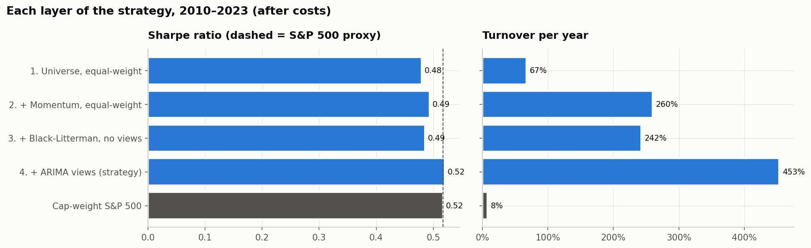
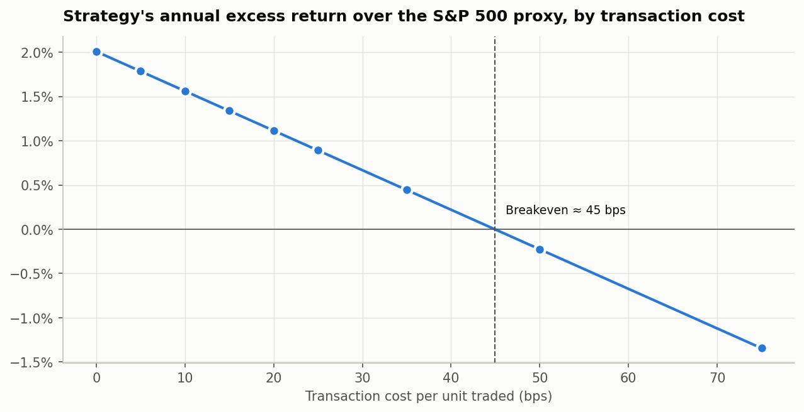
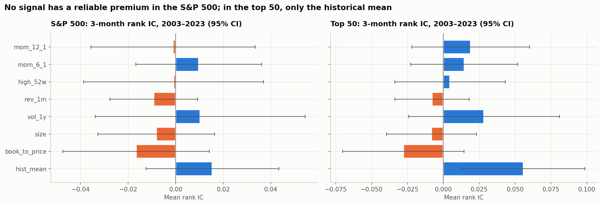
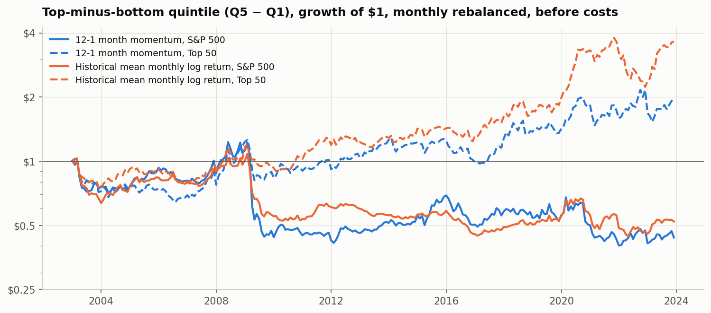
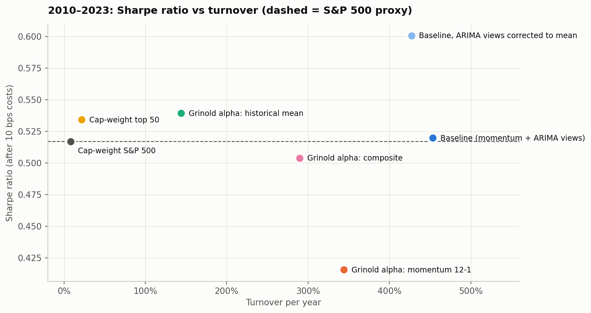
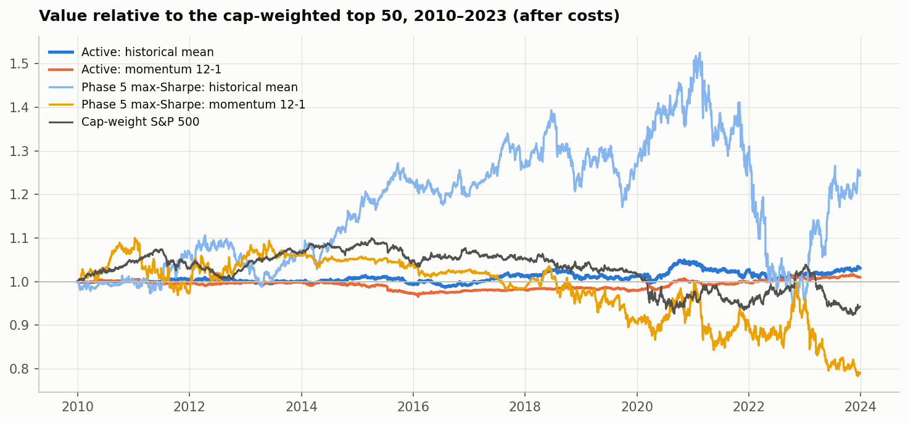
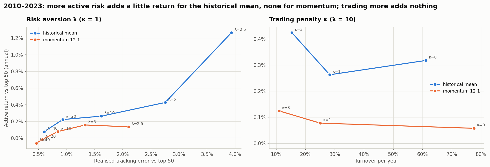
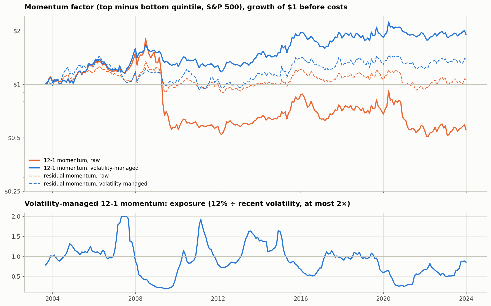
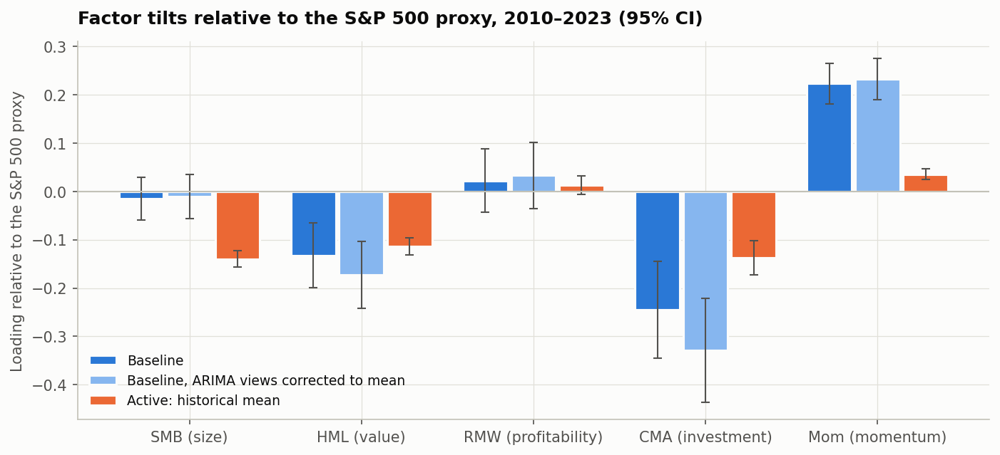
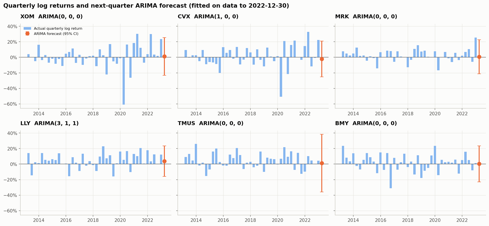

# Momentum Trading Strategy

A research project that selects S&P 500 stocks with a momentum signal, forms return views with ARIMA, and allocates the portfolio with Black-Litterman. The strategy is tested in quarterly walk-forward backtests (2023, and 2010–2023), after transaction costs, against market benchmarks.

> **Status:** Phases 1–8 are complete; dividends remain blocked by the data. **Conclusion:** over 2010–2023 the strategy returned 12.2% a year against 11.1% for an S&P 500 proxy, but with more risk. Its Sharpe ratio is the same (0.52 vs 0.52) and the outperformance is not statistically significant (t-statistic 0.58). **Phase 5** shows why: [signal research](#signal-research-phase-5) finds no momentum premium in the S&P 500 over 2003–2023, so there was little for any portfolio to capture. **Phase 6** fixes the [portfolio construction](#portfolio-construction-phase-6) (turnover 453% → 28% a year, tracking error under control), which leaves the strategy earning about the benchmark: the signals carry almost no information. **Phase 7** tests [better momentum signals](#momentum-variants-and-risk-forecasts-phase-7): volatility management transforms the momentum factor's crash risk, but neither it nor residual momentum helps the long-only top-50 portfolio. **Phase 8** [checks the conclusion](#attribution-and-robust-inference-phase-8) with the real T-bill rate, Fama-French attribution and multiple-testing corrections across all 47 variants: with the real risk-free rate the baseline trails the S&P 500 (Sharpe 0.625 vs 0.640), its extra return is a momentum-and-growth tilt, and no variant survives the corrections.


---

## Results

2010–2023, walk-forward, after 10 bps costs, price returns:

| | CAGR | Volatility | Sharpe | Max drawdown | Turnover / yr | t-stat vs S&P | 2023 |
|---|---|---|---|---|---|---|---|
| **Strategy** | **12.2%** | 20.4% | **0.52** | −33.0% | 453% | 0.58 | 11.5% |
| Equal-weight top 50 | 10.1% | 16.8% | 0.48 | −31.1% | 67% | −1.46 | 23.1% |
| Cap-weight top 50 | 11.5% | 17.9% | 0.53 | −30.0% | 22% | 0.51 | 37.2% |
| Cap-weight S&P 500 (index proxy) | 11.1% | 17.5% | 0.52 | −33.6% | 8% | — | 25.7% |

The S&P 500 proxy tracks the real index closely: 25.6% vs 24.2% before costs in 2023, and 11.1% vs about 10.9% a year over 2010–2023.

### Year by year

The strategy beat the S&P 500 proxy in 8 of 14 years, but its bad years (2010, 2016, 2023) were large.


### Risk over time

Drawdowns are similar to the index's, but the strategy's rolling 3-year Sharpe has fallen behind since 2022.


### Where the return comes from

Each layer was added one at a time. Momentum, the optimiser and the ARIMA views each move the Sharpe ratio by 0.03 or less, while turnover rises nearly sevenfold.



### How sensitive the result is

Across 13 variants of the settings and costs, the Sharpe ranges from 0.43 to 0.60. None is statistically significant (best t-statistic ≈ 1.2).


### Transaction costs

The strategy trades a lot, so costs matter: its edge over the S&P 500 proxy disappears at about **45 bps** per trade.



### Full S&P 500 universe

Running the same momentum selection on all ~500 members made results **worse**. The strategy's Sharpe fell to 0.29, and classic top-decile momentum got 0.33, against 0.47 for equal-weight S&P 500. Large-cap US momentum was a weak factor in 2010–2023.


### Reducing turnover

Moving only 50% of the way to the target each quarter halves turnover (453% → 225%) and raises the Sharpe to 0.58 (t-statistic 1.15). No-trade bands barely help, because most trades are whole-position swaps. This was found after testing several variants, so it needs confirming on fresh data.


### 2023 test year

Momentum at the end of 2022 pointed towards energy and defensive stocks, while 2023 was led by mega-cap tech: 11.5% for the strategy against 25.7% for the S&P proxy.


---

## Signal research (Phase 5)

[`signal-research.ipynb`](signal-research.ipynb) tests each signal on its own before building portfolios, then
turns signals into expected returns the standard way and measures how much of the signal reaches the portfolio.
Monthly, 2003–2023, point-in-time S&P 500 (about 500 stocks) and its 50 largest members.



* **No momentum premium.** In the full S&P 500 no signal has a significant information coefficient (IC) at
  1, 3, 6 or 12 months. 12-1 momentum's top-minus-bottom quintile earned −1.8% a year (t −0.41); it crashed
  in the 2009 rebound and never recovered.
* **The historical-mean signal is the 2017–2023 growth rally.** It is the only significant signal in the top 50
  (3-month IC 0.056, t 2.5), but its IC is 0.001 in 2003–2009, 0.034 in 2010–2016 and 0.136 in 2017–2023, and
  it falls to t 1.21 once momentum, size, volatility, value and reversal are controlled for (Fama-MacBeth). It
  is correlated −0.35 with book-to-price: it picks growth stocks.



* **Grinold alphas** (alpha = IC × volatility × z-score, IC estimated only from past data) make the portfolio
  follow its signal: the transfer coefficient rises from about 0.16 to 0.70, and it holds 12–23 names instead
  of 7. With no alpha, the optimiser returns the market portfolio, as it should.
* **But the signals are weak and max-Sharpe overtrades them.** A momentum alpha with a standard deviation of
  0.8% a year still produces 344% turnover and a Sharpe of 0.42. The historical-mean alpha reaches 0.54 but
  with a −50.5% drawdown in 2021-22, holding Tesla and Mastercard at the 20% cap.
* **Since 2005, nothing beats cap-weighting** (Sharpe 0.32 for both benchmarks, including 2008-09).
* **A bug in the ARIMA views:** they were median, not expected, returns, which penalised volatile stocks.
  Correcting them raises the baseline's Sharpe from 0.52 to 0.60 (t 1.26, not significant).



---

## Portfolio construction (Phase 6)

[`portfolio-construction.ipynb`](portfolio-construction.ipynb) replaces max-Sharpe with the standard
active-management setup: a **statistical risk model** (5 principal components of daily returns plus each
stock's specific risk) and a **benchmark-relative optimiser** that maximises alpha minus a penalty on
tracking error against the cap-weighted top 50 and the cost of each trade:

$$\max_w \; h\,\alpha^\top(w-b) - h\,\lambda\,(w-b)^\top\Sigma(w-b) - \kappa\,c\,\lVert w - w_{\text{current}}\rVert_1$$

long-only, at most 20% per stock, tracking error at most 4%. Alphas are Phase 5's Grinold alphas, now
scaled by specific volatility. Main settings: $\lambda = 10$ (from Grinold's TE ≈ IC√N/λ, about 2% here)
and $\kappa = 1$ (trades charged at their real cost).

2010–2023, after 10 bps costs; active statistics against the cap-weighted top 50:

| | Sharpe | Turnover / yr | Active return | Tracking error | IR (t) | Max drawdown |
|---|---|---|---|---|---|---|
| Active: historical mean | 0.54 | 28% | +0.3% | 1.6% | 0.16 (0.61) | −31.3% |
| Active: momentum 12-1 | 0.54 | 25% | +0.1% | 0.8% | 0.09 (0.34) | −29.5% |
| Active: composite | 0.54 | 40% | +0.3% | 1.5% | 0.20 (0.74) | −30.1% |
| Phase 5 max-Sharpe: historical mean | 0.54 | 144% | +2.4% | 9.4% | 0.26 (0.97) | −50.5% |
| Phase 5 max-Sharpe: momentum 12-1 | 0.42 | 344% | −1.3% | 7.6% | −0.17 (−0.65) | −32.3% |
| Cap-weight top 50 | 0.53 | 22% | — | — | — | −30.0% |



* **The construction problem is solved.** The same or a higher Sharpe ratio for a fifth of the turnover or
  less (the benchmark itself turns over 22% from index changes), tracking error of 0.8–1.6% instead of
  7.6–9.4%, and drawdowns within 1.3 points of the benchmark's (−30.0%). The portfolios hold 44–48 names, and 86–89% of their active risk is stock-specific.
* **Which exposes how little the alphas are worth:** +0.1% to +0.3% a year, none significant, and +0.1%,
  −0.1% and +0.2% over 2005–2023.
* **The optimised portfolios were riskier than forecast.** Realised tracking error divided by the forecast (the bias
  statistic) is 1.17 for the historical mean, at the edge of the range expected from an accurate model
  (0.81–1.19), and 1.32–1.57 for the other two. Phase 7 finds why: not the risk model itself, which is
  accurate for random portfolios, but misalignment between the alpha and the risk model.
* **Sensitivity** (every setting reported): more active risk adds a little return for the historical mean
  (+1.3% at 3.9% tracking error, t 1.20) and none for momentum; a higher trading penalty cuts turnover to
  11–15% at no cost in return.



---

## Momentum variants and risk forecasts (Phase 7)

[`momentum-variants-and-risk.ipynb`](momentum-variants-and-risk.ipynb) tests the two standard improvements to
momentum and diagnoses Phase 6's low risk forecasts.

**Volatility-managed momentum** (Barroso & Santa-Clara 2015, their settings: 12% target, 6-month window, at
most 2×) on the S&P 500 top-minus-bottom momentum quintile, 245 months, before costs:

| | Return / yr | Sharpe (t) | Max drawdown | Worst month | Skewness |
|---|---|---|---|---|---|
| 12-1 momentum, raw | −1.0% | −0.05 (−0.23) | −71.8% | −33.6% | −0.89 |
| 12-1 momentum, volatility-managed | +4.0% | 0.31 (1.50) | −29.5% | −11.3% | +0.45 |
| Residual momentum, raw | +1.0% | 0.09 (0.39) | −33.2% | −13.7% | −0.25 |
| Residual momentum, volatility-managed | +2.4% | 0.19 (0.89) | −35.4% | −12.8% | +0.19 |



* **Volatility management removes the momentum crash** (−71.8% → −29.5% drawdown, worst month −33.6% → −11.3%),
  reproducing the paper; the higher return is not significant (t 1.50).
* **Residual momentum** (Blitz, Huij & Martens 2011; market factor only) is steadier than 12-1 momentum in the
  top 50 (3-month IC positive in all three sub-periods; quintile spread +4.6% a year, t 1.62) but has no premium
  in the full S&P 500 and adds nothing once 12-1 momentum is controlled for.
* **Neither helps the long-only top-50 portfolio:** through the Phase 6 optimiser both earn 0.0% a year
  against the cap-weighted top 50. There is no momentum information there to scale.
* **The risk model was accurate all along.** Exponential weighting, Phase 6's suggested fix, makes the
  forecasts slightly worse. The model's bias statistic is 0.98 for 11,200 random active portfolios and 0.98
  for specific risk; only optimised portfolios were under-forecast, because the optimiser bets along the alpha,
  which the model had no factor for. Adding the alpha as a factor (Lee & Stefek 2008) brings the
  historical-mean portfolio from 1.17 to 1.10, within the range of an accurate model. Momentum stays at 1.52,
  driven by two extreme quarters (Q3 2020, +5.3 standard deviations; Q3 2015, −4.9).


---

## Attribution and robust inference (Phase 8)

[`attribution-and-inference.ipynb`](attribution-and-inference.ipynb) rebuilds all 47 variants tested in Phases
1–7 (`mts.strategies`) over 2010–2023 and applies four checks. Factor returns and the 1-month T-bill come
from [Kenneth French's data library](https://mba.tuck.dartmouth.edu/pages/faculty/ken.french/data_library.html)
(CRSP vintage 202609; URLs and checksums in `factors/manifest.json`).

| | Sharpe (T-bill) | vs S&P 500 proxy (bootstrap p) | Factor alpha vs S&P 500 proxy (t) | Momentum loading | CMA loading |
|---|---|---|---|---|---|
| Baseline | 0.625 | −0.015 (0.91) | +0.69% (0.30) | +0.22 | −0.24 |
| Best variant by Sharpe (max weight 10%) | 0.715 | +0.075 (0.51) | +1.67% (0.97) | +0.20 | −0.16 |
| Best variant by IR (ARIMA views corrected) | 0.703 | +0.063 (0.66) | +2.41% (1.02) | +0.23 | −0.33 |
| Phase 6 active, historical mean | 0.660 | +0.020 (0.73) | +0.34% (0.43) | +0.04 | −0.14 |
| Cap-weight S&P 500 proxy | 0.640 | — | — | — | — |



* **Real risk-free rate.** The T-bill averaged 0.84% a year, not 3%. Every Sharpe ratio rises by 0.10–0.13,
  and the baseline now trails the S&P 500 proxy (0.625 vs 0.640).
* **Attribution.** Relative to the S&P 500 proxy, the baseline is long momentum (+0.22, t 10.5) and tilted
  against conservative-investment and value stocks (CMA −0.24, HML −0.13): what is left is +0.69% a year
  (t 0.30). The Phase 6 portfolio has the cap-weighted top 50's mega-cap tilts. Across all 47 variants, factor
  alpha t-statistics range from −1.79 to +1.02.
* **Sharpe differences** (block bootstrap): none has a p-value below 0.37.
* **Multiple testing.** The best of 47 information ratios (0.338) beats what luck alone would give (0.238 for
  47 independent tries) but its deflated Sharpe ratio is 0.65, or 0.80–0.86 allowing for how correlated the
  variants are (2.2–4 effective trials); 0.95 is the usual bar.
* **Overfitting.** Within each group of variants, against its own benchmark, the probability of backtest
  overfitting is 0.49 (Phases 1–5) and 0.65 (Phases 6–7), and the in-sample winner's IR falls from 0.46–0.49
  to 0.01–0.12 out of sample.


---

## How the pipeline works

All the main work is in [`main.ipynb`](main.ipynb). On each rebalance date (the last trading day of each quarter), it runs:

```
Clean data ─▶ Point-in-time universe ─▶ Momentum selection ─▶ ARIMA views ─▶ Black-Litterman ─▶ Hold one quarter (pay costs)
```

1. **Data cleaning.** Removes exchange suffixes from tickers (`AAPL UW Equity` → `AAPL`). Drops blank rows (28% of the raw file) *before* de-duplicating. When a company has two listings with different prices, keeps the one named in that date's S&P 500 snapshot.
2. **Point-in-time universe.** The 50 largest stocks that were **in the S&P 500 on that date**, taken from the quarterly constituent snapshots. This avoids survivorship bias.
3. **Momentum selection.** Ranks the universe by 12-1 month momentum (12-month return, skipping the latest month), excludes overbought stocks (RSI > 70), and keeps the top 25.

   

4. **ARIMA views.** `auto_arima` on each stock's quarterly **log returns**, with no seasonal term and the intercept forced on. The next-quarter forecast becomes the stock's Black-Litterman view. The 95% intervals are wide, so the views carry little information. Forecasts are fitted in parallel and cached.

   

5. **Black-Litterman.** A market-cap-implied prior blended with the ARIMA views, all in annual excess returns, using a Ledoit-Wolf shrunk covariance. The optimiser maximises Sharpe, long-only, with at most 20% in any one stock.

   

6. **Backtest.** Holdings drift with prices for one quarter, then the process re-runs using only data up to the next rebalance date. Every portfolio, benchmarks included, pays 10 bps per unit traded.

### Files

| File | Purpose |
|------|---------|
| `main.ipynb` | The full pipeline, backtests, analysis and findings (a few minutes; faster once the ARIMA cache exists) |
| `signal-research.ipynb` | Phase 5: signal tests (IC, quintiles, Fama-MacBeth) and Grinold-alpha portfolios (about 1 minute once `main.ipynb` has built the ARIMA cache) |
| `portfolio-construction.ipynb` | Phase 6: risk model, benchmark-relative optimiser, forecast vs realised risk, sensitivity (about 4 minutes) |
| `momentum-variants-and-risk.ipynb` | Phase 7: residual and volatility-managed momentum, risk-forecast diagnostics, alpha-aligned risk model (about 4 minutes) |
| `attribution-and-inference.ipynb` | Phase 8: all 47 variants rebuilt; T-bill Sharpe ratios, factor attribution, bootstrap tests, deflated Sharpe ratio, probability of backtest overfitting (about 8 minutes the first time, then cached) |
| `mts/` | Package shared by the Phase 5–8 notebooks: `data` (cleaning, point-in-time universe), `baseline` (the `main.ipynb` strategy, same logic), `backtest`, `signals`, `risk`, `optimize`, `strategies` (every variant tested), `factors` (Fama-French download), `inference` (bootstrap, deflated Sharpe, PBO), `plotting`, `config` |
| `tests/` | Unit tests on synthetic data (Black-Litterman identities, Grinold alpha, point-in-time IC, risk model, optimiser constraints); no Bloomberg data needed |
| `results/` | Tables behind every Phase 5–8 number in this README, as CSV |
| `factors/` | Fama-French factor files (downloaded, not committed) and `manifest.json` with their URLs, checksums and CRSP vintage |
| `images/` | Charts exported by the notebooks and used in this README |
| `requirements.txt` | Package versions the notebook was verified with |
| `archive/` | Phase 1 notebooks, kept for reference |
| `cache/` | ARIMA forecasts, cleaned data and the monthly signal panel, created by the notebooks (not committed) |

### Data (not included)

The data is not in this repository: it is too large for GitHub and may not be redistributable. The notebook expects:

- `tickers/SPX as of <date>.xlsx`: quarterly snapshots of S&P 500 constituents, 2000–2023 (columns include `Ticker`)
- `tickers/spx_companies_historical_data.csv`: daily data for each ticker, with these columns:
  `ticker, date, PX_OPEN, PX_HIGH, PX_LOW, PX_LAST, PX_VOLUME, DVD_YLD_IND, EPS, BOOK_VAL_PER_SH, CUR_MKT_CAP`

Prices are split-adjusted. `DVD_YLD_IND` and `EPS` are empty in every row. `BOOK_VAL_PER_SH` is stamped at the fiscal period end, before it is published, so Phase 5 lags it by about 3 months.

Phase 8 also uses the daily Fama-French five factors, the daily momentum factor and the monthly 1-month T-bill return from Kenneth French's data library, downloaded by `python -m mts.factors` (public; recorded in `factors/manifest.json`).

### Setup

```bash
pip install -r requirements.txt
python -m pytest tests/                       # unit tests, no data needed (about 2 seconds)
jupyter notebook main.ipynb                   # baseline; builds the ARIMA cache used by Phases 5 and 6
python -m mts.factors                         # Fama-French factors and T-bill rate for Phase 8
jupyter nbconvert --to notebook --execute --inplace signal-research.ipynb portfolio-construction.ipynb \
    momentum-variants-and-risk.ipynb attribution-and-inference.ipynb
```

The Phase 5 and 6 notebooks first check that the `mts` package reproduces the baseline exactly
(Sharpe 0.52, 453% turnover) before running anything new.

---

## Project phases

### Phase 1: Baseline

The first working version of the pipeline (now in `archive/`).

- Extracted the S&P 500 constituent snapshots from Excel
- Cleaned the data: merged ticker suffixes and removed duplicate dates
- Split into train (2000–2022) and test (2023)
- Ran ARIMA forecasts with SMA/EMA overlays for the top 50 stocks by market cap
- Computed RSI, MACD and ROC indicators
- Built a Black-Litterman portfolio allocation
- Built quarterly rebalancing over 2023

**Phase 1 output:** a Sharpe ratio of 12.91. A review found this came from the bugs fixed in Phase 2, so it has no meaning.

### Phase 2: Correctness fixes

#### Critical: these changed the results

| # | Task | Problem | Fix |
|---|------|---------|-----|
| 2.1 | Fix the Black-Litterman views | `P @ tau * cov_matrix @ P.T` ran `P @ tau` first, which raised an error. The code caught it and silently fell back to the implied returns, so the views were never applied. | Correct formula: `P @ (tau * Sigma) @ P.T`. Also fixed the posterior covariance, which used `tau * inv(Sigma)` instead of `inv(tau * Sigma)`. |
| 2.2 | Fix the weight labels | The covariance matrix was in alphabetical order, but the weights were labelled in ranking order, so each printed weight belonged to a different stock. | Every vector is built from one ordered ticker list and stays labelled by ticker. |
| 2.3 | Fix the return and Sharpe calculations | A 3% annual risk-free rate was added to *daily* returns, the Sharpe ratio never subtracted the risk-free rate, and the market risk premium was used as the risk-aversion coefficient. | Everything is annualised and in excess returns, with δ = MRP / market variance. Sharpe = (return − risk-free) / volatility. |
| 2.4 | Remove look-ahead from stock selection | Stocks were chosen by comparing forecasts with the actual 2023 returns, then tested on 2023. | Selection uses only data up to each rebalance date. |
| 2.5 | Make the backtest walk forward | Weights were fitted and scored on the same quarter, the quarterly return was the mean daily return, Q1 was never scored, and the portfolio value was never reported. | Form on quarter-end *t*, hold buy-and-hold to *t+1*, and chain the values. All four 2023 quarters are scored and plotted. |
| 2.6 | Add a benchmark | There was nothing to compare against. | Equal-weight top 50, cap-weight top 50 and a cap-weight S&P 500 proxy, reporting CAGR, volatility, Sharpe and maximum drawdown. Also added a 2010–2023 backtest (56 rebalances). |

#### Method improvements

| # | Task | Problem | Fix |
|---|------|---------|-----|
| 2.7 | Use a real momentum signal | The ARIMA-accuracy screen favoured flat, defensive stocks, and RSI/MACD were not used in any decision. | Stocks are selected by 12-1 momentum with an RSI < 70 filter. ARIMA now supplies the Black-Litterman views. |
| 2.8 | Improve the ARIMA setup | Fitted to raw prices with a fake quarterly seasonality. TSLA's forecast fell to $4.25. | Fitted to quarterly log returns with no seasonal term. The chosen order is refitted with an intercept so a (0,0,0) model forecasts the stock's mean return, not 0. |
| 2.9 | Remove survivorship bias | The universe was each stock's latest market cap over the whole period, and delisted tickers crashed the loop. | Point-in-time universe from the constituent snapshots. Delisted stocks hold their last price. |

#### Housekeeping

| # | Task | Problem | Fix |
|---|------|---------|-----|
| 2.10 | Make the notebook run from a fresh kernel | Wrong data path and a missing `import re`. | Fixed. Verified with a full top-to-bottom run. |
| 2.11 | Speed up the data cleaning | Loops that grew a DataFrame with `pd.concat` on 6.8M rows, and helper functions that did nothing. | One `dropna` + `drop_duplicates`. Loading and cleaning now take about 10 seconds. |
| 2.12 | Fix wrong labels | Printouts said "2023–2024" when the data ends on 2023-12-29. | All labels match the data. |
| 2.13 | Consolidate the notebooks | Three overlapping notebooks. | Old notebooks moved to `archive/`. `main.ipynb` is the single source. |
| 2.14 | Pin the dependencies | No `requirements.txt`. | Added. |

The notebook also went from 18MB to under 1MB: it now has 5 summary charts instead of 81 per-stock plots.

### Phase 3: Robustness (1 task blocked by data)

| # | Task | Outcome |
|---|------|---------|
| 3.1 | Include dividends (total return) | The dataset's dividend field (`DVD_YLD_IND`) is empty in every row, so total returns cannot be computed. Needs a total-return series (for example Bloomberg `TOT_RETURN_INDEX_GROSS_DVDS`) or dividend history. All results are labelled as price returns. |
| 3.2 | Model transaction costs | Holdings now drift between rebalances, turnover is measured against the drifted weights, and every portfolio pays 10 bps per unit traded. The strategy trades 453% a year against 8% for the S&P proxy; its advantage disappears at about 45 bps. |
| 3.3 | Test parameter sensitivity | Varied the weight cap, number of stocks, RSI filter, τ, covariance method and costs one at a time, and split the period in half. Sharpe ranges from 0.43 to 0.60 (S&P: 0.52); none is significant. Also added information ratios and t-statistics against the S&P proxy. |
| 3.4 | Compare against simpler alternatives | Layer-by-layer comparison: momentum adds +0.01 Sharpe, the optimiser +0.00, ARIMA views +0.03 (with about double the turnover). |
| 3.5 | Shrink the covariance estimate (Ledoit-Wolf) | Now the default. It makes no measurable difference here, because the 20% weight cap already limits how far the optimiser can chase noise. Also found that τ has no effect on the posterior mean, since the He-Litterman Ω is proportional to τ. |
| 3.6 | Fix ticker reuse | Investigated: Bloomberg already gives delisted companies unique codes, so no two companies share a symbol (the only name change in the snapshots is a rename, Boston Properties → BXP). The real issue was duplicate listings disagreeing on price (740 of 421k overlapping dates differ by more than 0.5%). Cleaning now keeps the listing named in each date's snapshot. |

### Phase 4: Extensions

| # | Task | Outcome |
|---|------|---------|
| 4.1 | Run momentum on the full S&P 500 | All ~500 members, point-in-time. Results got worse: strategy Sharpe 0.29, classic top-decile momentum 0.33, against 0.47 for equal-weight S&P 500. Added an equal-weight S&P 500 benchmark. |
| 4.2 | Reduce turnover | Added no-trade bands and partial rebalancing to the backtest engine. Partial rebalancing (50%) halves turnover and lifts the Sharpe to 0.58 (t-statistic 1.15). Bands barely help, because trades are whole-position swaps. |
| 4.3 | Visual report | 12 charts, built on one colour-blind-checked palette with a fixed colour per portfolio, exported to `images/` and shown in this README. |
| 3.1 | Dividends (carried over) | Still blocked. The free alternative (Yahoo Finance) has no data for most delisted companies, so it would cover the survivors only and reintroduce survivorship bias. Needs a point-in-time total-return source (CRSP, or Bloomberg `TOT_RETURN_INDEX_GROSS_DVDS`). |

### Phase 5: Signal research

| # | Task | Outcome |
|---|------|---------|
| 5.1 | Test each signal on its own | Eight signals, monthly 2003–2023, full S&P 500 and top 50: rank IC at 1/3/6/12 months with Newey-West t-statistics, three sub-periods, quintile portfolios, Fama-MacBeth regressions. No momentum premium; the historical-mean IC comes from 2017–2023 and is not significant after controls |
| 5.2 | Grinold alphas into Black-Litterman | alpha = IC × volatility × z-score with point-in-time IC estimates; prior over all 50 stocks; transfer coefficient measured (about 0.70). Backtested 2010–2023 and 2005–2023 |
| 5.3 | Check the data before using it | Prices are split-adjusted; `EPS` is empty; book value has about one quarter of look-ahead, so it is lagged |
| 5.4 | Correct the ARIMA views from median to expected returns | Found in review: e^(4m) − 1 understates the expected return by about σ²/2. Tested as a variant (Sharpe 0.52 → 0.60); `main.ipynb` itself is unchanged |

### Phase 6: Portfolio construction

| # | Task | Outcome |
|---|------|---------|
| 6.1 | Statistical risk model | 5 principal components of 3 years of daily returns plus specific risk, refitted each quarter; explains 63% of variance on average. Gives specific volatility for the alphas and splits active risk into factor and specific parts |
| 6.2 | Benchmark-relative optimiser | Alpha minus risk and trading penalties, tracking-error cap, long-only, 20% cap; starts from the drifted holdings so each trade's cost counts. Turnover 453% → 25–40%, tracking error 0.8–1.6% |
| 6.3 | Check the risk model's forecasts | Bias statistic 1.17–1.57: realised tracking error is higher than forecast |
| 6.4 | Package and tests | `research.py` replaced by the `mts/` package; 20 unit tests on synthetic data; every Phase 5 and 6 table exported to `results/`. The Phase 5 notebook gives the same numbers on the package |

### Phase 7: Momentum variants and risk forecasts

| # | Task | Outcome |
|---|------|---------|
| 7.1 | Residual momentum | 36-month market-model residuals, 12-1 window, scaled by residual volatility. Steadier than 12-1 momentum in the top 50, no premium in the S&P 500 |
| 7.2 | Volatility-managed momentum | Momentum factor: drawdown −71.8% → −29.5%, Sharpe −0.05 → 0.31 (t 1.50). No effect in the long-only portfolio |
| 7.3 | Exponentially weighted risk model | Half-lives of 126, 63 and 42 days make the forecasts slightly worse; it was the wrong diagnosis in Phase 6 |
| 7.4 | Diagnose the risk forecasts | Accurate for random portfolios (0.98) and specific risk (0.98); the alpha-aligned model fixes the historical-mean portfolio (1.17 → 1.10); momentum's error comes from two extreme quarters |
| 7.5 | Code | `risk.add_alpha_factor`, exponential weights, `signals.residual_momentum`, `signals.vol_scale`, `backtest.bias_statistic`; 29 unit tests in all |

### Phase 8: Attribution and robust inference

| # | Task | Outcome |
|---|------|---------|
| 8.1 | Fama-French data and the real risk-free rate | Daily five factors and momentum, monthly T-bill (CRSP vintage 202609), with a manifest of URLs and checksums. T-bill averaged 0.84% a year; the baseline's Sharpe ratio is 0.625 vs 0.640 for the S&P 500 proxy |
| 8.2 | Every variant in one place | `mts.strategies` rebuilds all 47 variants from Phases 1–7 and reproduces their reported results |
| 8.3 | Factor attribution | Relative to the S&P 500 proxy: momentum-and-growth tilts for the baseline, mega-cap tilts for the optimised portfolios; factor alpha t-statistics from −1.79 to +1.02 |
| 8.4 | Sharpe-ratio tests | Block bootstrap: no difference significant (lowest p-value 0.37) |
| 8.5 | Multiple-testing corrections | Deflated Sharpe ratio of the best variant 0.65–0.86; PBO 0.49 and 0.65 within each group of variants |
| 8.6 | Code | `mts.factors`, `mts.inference`, `mts.strategies`; 36 unit tests in all |

---

## Next steps: ideas

Phase 5 covered the signal research in section 2 below (evaluating each signal, the historical-mean follow-up, extending back to 2005) and replaced Idzorek-style view confidence with Grinold alphas. Phase 6 covered section 4 (benchmark-relative optimisation with a tracking-error budget and a turnover penalty, with the transfer coefficient reported) and the package and unit tests in section 7. Phase 7 tested residual and volatility-managed momentum (section 2) and diagnosed the risk forecasts: the risk model is accurate, and aligning it with the alpha fixes the forecasts for the historical-mean strategy. Phase 8 covered the factor attribution and real T-bill rates (section 3) and the deflated Sharpe ratio, bootstrap tests and PBO (section 5). What remains is mainly **signals with real information in large caps**, which none tested so far have, and **out-of-sample confirmation** on data from 2024 onwards.

### What a re-check of the results found

These checks were run on the existing pipeline (2010–2023, top-50 universe, after 10 bps costs). They change where the project should go next.

| Check | Result | What it means |
|---|---|---|
| ARIMA orders chosen (4,049 fits) | 63% are (0,0,0) and another 12% are (0,0,1) | The "ARIMA views" are mostly each stock's historical average return |
| Beta and alpha vs the S&P 500 proxy (daily, Newey-West) | Beta 1.01, alpha +1.45% a year, t = 0.57 | The extra volatility is not market exposure; it is stock-specific risk |
| Concentration | Median 7 names held; 3 or more names at the 20% cap in 73% of rebalances | The portfolio is a few concentrated bets, so low t-statistics are almost built in |
| Rank IC: how well each signal ranks next-quarter returns (56 quarters) | ARIMA view +0.065 (t 2.3), plain historical mean +0.079 (t 2.5), 12-1 momentum +0.015 (t 0.5) | The ARIMA views are the only signal with measurable skill; momentum has almost none in this universe |
| One-day execution lag (decide on the close, trade the next day) | Sharpe 0.52 → 0.51 | Trading on the close the signal was observed at does not inflate the results |

**The main finding:** the forecasts rank stocks better than chance, but the portfolio construction does not turn that into returns. The fundamental law of active management (IR ≈ TC × IC × √breadth) gives a theoretical information ratio of about 0.9 for an IC of 0.065 across 50 stocks × 4 quarters a year. The actual IR is 0.15, so the transfer coefficient (TC, how much of the signal reaches the portfolio) is only about 0.16.

**Caveat:** 2010–2023 was a decade in which long-run winners such as mega-cap tech kept winning, so the historical-mean IC may simply reflect that. It needs testing on 2003–2009 and controlling for size and sector before it is trusted.

### 1. Reframe the research question
| Idea | Why |
|---|---|
| Lead with "Does a forecast-driven Black-Litterman overlay add value to large-cap momentum?" | Turns the negative result into the finding; the layer-by-layer attribution becomes the core of the project |
| Write a 3–5 page research note (PDF) | Abstract, method, results, limitations and references: the format quant research desks actually read. Link it at the top of the README |

### 2. Signal research
| Idea | Why |
|---|---|
| Evaluate each signal on its own before building portfolios | Standard practice: IC, IC decay at 1, 3, 6 and 12 months, quintile long-short spreads, and how often the signal's ranking changes |
| Follow up the historical-mean IC | Control for size and sector, and test 2003–2009, to see whether it is real skill or just the mega-cap tech decade |
| ~~Other momentum definitions~~ | Done: 6-1 and 52-week high (Phase 5), residual momentum (Phase 7); none has a premium in the S&P 500 |
| ~~Volatility-scaled momentum~~ | Done in Phase 7: removes the factor's crashes, adds nothing to the long-only top-50 portfolio |
| Multi-factor model with book-to-price | Value and momentum tend to be negatively correlated, so combining them usually gives a smoother result than either alone. `EPS` is empty in the data, so value is book-to-price only (lagged 3 months; see Phase 5) |
| Market trend filter | Hold cash or the index when the S&P 500 is below its 200-day average, to avoid momentum's worst periods |
| Monthly rebalancing | Momentum signals decay quickly; quarterly may be too slow, though costs rise |
| Cross-sectional model instead of ARIMA | For example gradient boosting on momentum, value and volatility features to rank stocks, instead of 25 separate time-series models |

### 3. Performance attribution
| Idea | Why |
|---|---|
| ~~Factor regressions against Fama-French 5 factors plus momentum~~ | Done in Phase 8: the baseline's extra return is a momentum-and-growth tilt; no factor alpha is significant |
| ~~Use real T-bill rates for the risk-free rate~~ | Done in Phase 8 for every Sharpe ratio (average 0.84% a year). Still to do: the Black-Litterman views in `main.ipynb` (Q = forecast − 3%) |
| Sector classifications (GICS) | Enables sector attribution, sector-neutral momentum and sector caps; in 2023 the strategy was effectively a sector bet against tech |

### 4. Portfolio construction
| Idea | Why |
|---|---|
| ~~Mean-variance against the benchmark with a tracking-error target~~ | Done in Phase 6 |
| ~~Set view confidence from forecast accuracy (Idzorek)~~ | Superseded by Grinold alphas in Phase 5 |
| ~~Turnover penalty inside the optimiser~~ | Done in Phase 6 |
| ~~Exponentially weighted risk model~~ | Tested in Phase 7: it does not help; the cause was alpha–risk misalignment, fixed with an alpha factor |
| Compare other allocators | Minimum-variance, risk parity or hierarchical risk parity on the same picks |

### 5. Making the results trustworthy
| Idea | Why |
|---|---|
| Extend the backtest back to 2003 | The data starts in 2000; 2003 is the earliest date with full lookback windows. It adds the 2008 crisis and the 2009 rebound, when momentum famously crashed |
| ~~Deflated Sharpe ratio, block-bootstrap confidence intervals and the probability of backtest overfitting (PBO)~~ | Done in Phase 8 across all 47 variants |
| Out-of-sample confirmation | Fix the best settings (such as partial rebalancing) now and test them only on new data from 2024 onwards |
| Walk-forward parameter selection | Let the backtest choose its settings using only past data at each date, instead of fixing them up front |
| Random-portfolio benchmark | Compare against thousands of random portfolios of the same size to see where the strategy ranks by luck alone |

### 6. Better data and costs
| Idea | Why |
|---|---|
| Total-return data (CRSP or Bloomberg) | Unblocks 3.1 and removes special-dividend artifacts such as KDP's −82% "crash" in 2018 |
| Spread plus square-root market-impact cost model | The data already has `PX_VOLUME`, which is enough to model impact and estimate how much capital the strategy could run |

### 7. Engineering
| Idea | Why |
|---|---|
| ~~Move the code into a Python package with unit tests~~ | Done in Phase 6 (`mts/`, `tests/`). Still to do: test against the published He-Litterman example, and move `main.ipynb` onto the package |
| Synthetic sample dataset | Lets anyone run the notebook end-to-end without Bloomberg data |
| Continuous integration (GitHub Actions) | Run the tests and a small backtest on every push |
| Config file instead of notebook constants | Run experiments from the command line and log each run's settings and results |
| Interactive dashboard (Streamlit or Plotly) | Let readers change settings and see the backtest update |
