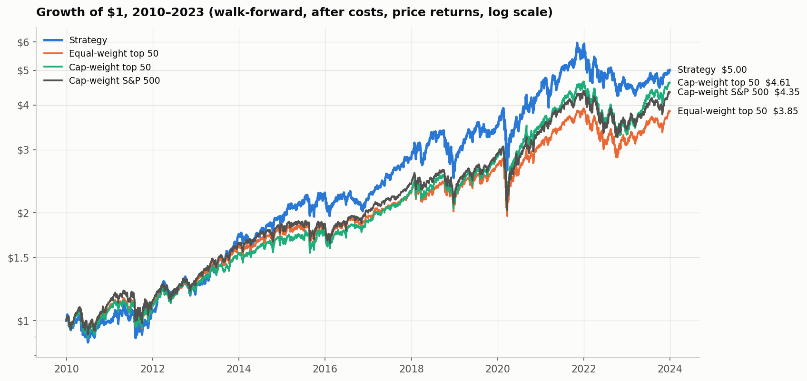
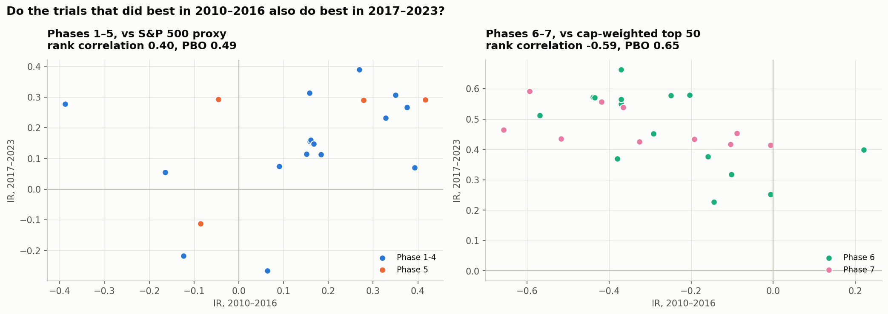

# Momentum Trading Strategy

**Does a forecast-driven Black–Litterman overlay add value to large-cap momentum?**
A quantitative research project on the point-in-time S&P 500, 2003–2023: a momentum strategy with ARIMA views
and Black–Litterman weights, taken from a first backtest to a full research pipeline with signal research,
risk modelling, benchmark-relative portfolio construction, factor attribution and multiple-testing corrections.


[](note/research-note.pdf)

> **Research note:** [`note/research-note.pdf`](note/research-note.pdf), 4 pages: question, method, results and limitations.

---

## The answer

The strategy holds the 25 strongest 12-1 month momentum stocks among the 50 largest S&P 500 members, turns ARIMA
return forecasts into Black–Litterman views and rebalances a max-Sharpe portfolio every quarter after costs.
Over 2010–2023 it returned **12.2% a year against 11.1%** for an S&P 500 proxy.

**That edge does not survive scrutiny.** With the actual T-bill rate its Sharpe ratio is **0.625 against the
index's 0.640**. Relative to the index it is a momentum-and-growth factor tilt with no significant alpha. Across
all **47 variants** tested, the best one fails the deflated Sharpe ratio test for having been picked among many,
and the variants that looked best in one period did not stay best in the next.



## Key findings

| Finding | Evidence |
|---|---|
| **No momentum premium** in the S&P 500, 2003–2023 | 12-1 momentum's 3-month rank IC is −0.001 (t −0.06); its top-minus-bottom quintile earned −1.8% a year |
| **The one predictive signal was a regime** | Each stock's historical mean return predicts the top 50 only in 2017–2023: IC 0.001, 0.034 and 0.136 in 2003–09, 2010–16 and 2017–23 |
| **Max-Sharpe overreacts to weak signals** | The baseline trades 453% a year; a benchmark-relative optimiser with risk and cost penalties trades 28% for a Sharpe ratio of 0.54 (baseline 0.52) |
| **Volatility management fixes momentum's crashes** | Momentum factor: maximum drawdown −71.8% → −29.5%, worst month −33.6% → −11.3% |
| **The edge is factor exposure, not skill** | Relative to the index: momentum loading +0.22 (t 10.5); factor alpha +0.69% a year (t 0.30) |
| **Nothing survives multiple testing** | Best of 47 variants: deflated Sharpe ratio 0.65–0.85 (the usual bar is 0.95); in-sample winners fall to an IR of 0.01–0.12 out of sample |




## What the project covers

| Area | Methods |
|---|---|
| **Data integrity** | Point-in-time universe from 168 quarterly constituent snapshots (no survivorship bias); duplicate listings resolved; look-ahead checks (book value lagged 3 months); walk-forward backtest with drifting holdings and transaction costs |
| **Signal research** | Rank information coefficients with Newey–West t-statistics, sub-periods, quintile portfolios, Fama–MacBeth regressions; 12-1, 6-1, 52-week-high, residual and volatility-managed momentum |
| **Expected returns** | Black–Litterman with He–Litterman uncertainty; ARIMA views; Grinold alphas (IC × volatility × score) with point-in-time IC estimates |
| **Risk** | Ledoit–Wolf shrinkage; statistical factor risk model; forecast-vs-realised risk tests (bias statistic); alpha-aligned risk model |
| **Portfolio construction** | Max-Sharpe vs benchmark-relative mean-variance with tracking-error and turnover penalties; transfer coefficient |
| **Evaluation** | Fama–French five factors plus momentum; real T-bill rates; block-bootstrap Sharpe-ratio tests; deflated Sharpe ratio; probability of backtest overfitting |

## Built to be checked

* **A tested package.** All logic lives in [`mts/`](mts/), with 37 unit tests on synthetic data (Black–Litterman
  identities, optimiser constraints, risk model, inference) that run without the proprietary data.
* **Every number is traceable.** The tables behind the README, the docs and the research note are in
  [`results/`](results/); the note is generated from them by [`note/build_note.py`](note/build_note.py).
* **Each step reproduces the last.** New work starts by reproducing earlier results exactly, and corrections
  are recorded where they were found (for example, Phase 7 overturned Phase 6's diagnosis of the risk forecasts).
* **External data is pinned.** The Fama–French factors are recorded with their URLs, checksums and CRSP vintage
  in [`factors/manifest.json`](factors/manifest.json).

## Quick start

```bash
pip install -r requirements.txt
python -m pytest tests/          # 37 unit tests, no data needed
```

The backtests need Bloomberg price data that is not redistributable; the expected files and the full run order
are in [project structure and setup](docs/project-structure.md).

## Documentation

| | |
|---|---|
| [Research note (PDF)](note/research-note.pdf) | The 4-page summary |
| [Results in full](docs/results.md) | Every result and chart, phase by phase |
| [Methodology](docs/methodology.md) | How the baseline pipeline works, step by step |
| [Project phases](docs/phases.md) | What each phase did and found, task by task, including corrections |
| [Project structure and setup](docs/project-structure.md) | Files, data, and how to run everything |
| [Next steps](docs/next-steps.md) | Ideas, and which have been done |
