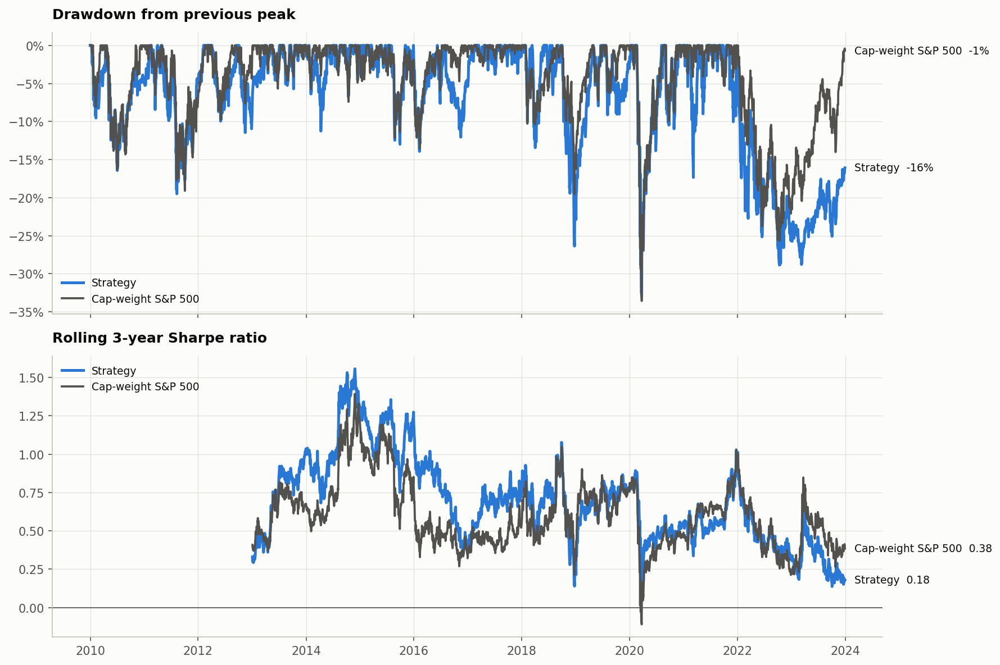
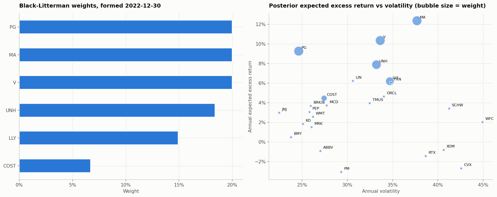

# Momentum Trading Strategy

A research project that selects S&P 500 stocks with a momentum signal, forms return views with ARIMA, and allocates the portfolio with Black-Litterman. The strategy is tested in quarterly walk-forward backtests (2023, and 2010–2023), after transaction costs, against market benchmarks.

> **Status:** Phases 1–4 are complete; dividends remain blocked by the data. **Conclusion:** over 2010–2023 the strategy returned 12.2% a year against 11.1% for an S&P 500 proxy, but with more risk. Its Sharpe ratio is the same (0.52 vs 0.52) and the outperformance is not statistically significant (t-statistic 0.58).


---

## Results

2010–2023, walk-forward, after 10 bps costs, price returns:

| | CAGR | Volatility | Sharpe | Max drawdown | Turnover / yr | t-stat vs S&P | 2023 |
|---|---|---|---|---|---|---|---|
| **Strategy** | **12.2%** | 20.4% | **0.52** | −33.0% | 453% | 0.58 | 11.5% |
| Equal-weight top 50 | 10.1% | 16.8% | 0.48 | −31.1% | 67% | −1.46 | 23.1% |
| Cap-weight top 50 | 11.5% | 17.9% | 0.53 | −30.0% | 22% | 0.51 | 37.2% |
| Cap-weight S&P 500 (index proxy) | 11.1% | 17.5% | 0.52 | −33.6% | 8% | — | 25.7% |

The S&P 500 proxy tracks the real index closely: 25.6% vs 24.2% before costs in 2023, and 11.1% vs about 10.9% a year over 2010–2023.

### Year by year

The strategy beat the S&P 500 proxy in 8 of 14 years, but its bad years (2010, 2016, 2023) were large.


### Risk over time

Drawdowns are similar to the index's, but the strategy's rolling 3-year Sharpe has fallen behind since 2022.



### Where the return comes from

Each layer was added one at a time. Momentum, the optimiser and the ARIMA views each move the Sharpe ratio by 0.03 or less, while turnover rises nearly sevenfold.


### How sensitive the result is

Across 13 variants of the settings and costs, the Sharpe ranges from 0.43 to 0.60. None is statistically significant (best t-statistic ≈ 1.2).


### Transaction costs

The strategy trades a lot, so costs matter: its edge over the S&P 500 proxy disappears at about **45 bps** per trade.


### Full S&P 500 universe

Running the same momentum selection on all ~500 members made results **worse**. The strategy's Sharpe fell to 0.29, and classic top-decile momentum got 0.33, against 0.47 for equal-weight S&P 500. Large-cap US momentum was a weak factor in 2010–2023.


### Reducing turnover

Moving only 50% of the way to the target each quarter halves turnover (453% → 225%) and raises the Sharpe to 0.58 (t-statistic 1.15). No-trade bands barely help, because most trades are whole-position swaps. This was found after testing several variants, so it needs confirming on fresh data.


### 2023 test year

Momentum at the end of 2022 pointed towards energy and defensive stocks, while 2023 was led by mega-cap tech: 11.5% for the strategy against 25.7% for the S&P proxy.


---

## How the pipeline works

All the main work is in [`main.ipynb`](main.ipynb). On each rebalance date (the last trading day of each quarter), it runs:

```
Clean data ─▶ Point-in-time universe ─▶ Momentum selection ─▶ ARIMA views ─▶ Black-Litterman ─▶ Hold one quarter (pay costs)
```

1. **Data cleaning.** Removes exchange suffixes from tickers (`AAPL UW Equity` → `AAPL`). Drops blank rows (28% of the raw file) *before* de-duplicating. When a company has two listings with different prices, keeps the one named in that date's S&P 500 snapshot.
2. **Point-in-time universe.** The 50 largest stocks that were **in the S&P 500 on that date**, taken from the quarterly constituent snapshots. This avoids survivorship bias.
3. **Momentum selection.** Ranks the universe by 12-1 month momentum (12-month return, skipping the latest month), excludes overbought stocks (RSI > 70), and keeps the top 25.

   

4. **ARIMA views.** `auto_arima` on each stock's quarterly **log returns**, with no seasonal term and the intercept forced on. The next-quarter forecast becomes the stock's Black-Litterman view. The 95% intervals are wide, so the views carry little information. Forecasts are fitted in parallel and cached.

   

5. **Black-Litterman.** A market-cap-implied prior blended with the ARIMA views, all in annual excess returns, using a Ledoit-Wolf shrunk covariance. The optimiser maximises Sharpe, long-only, with at most 20% in any one stock.

   

6. **Backtest.** Holdings drift with prices for one quarter, then the process re-runs using only data up to the next rebalance date. Every portfolio, benchmarks included, pays 10 bps per unit traded.

### Files

| File | Purpose |
|------|---------|
| `main.ipynb` | The full pipeline, backtests, analysis and findings (a few minutes; faster once the ARIMA cache exists) |
| `images/` | Charts exported by the notebook and used in this README |
| `requirements.txt` | Package versions the notebook was verified with |
| `archive/` | Phase 1 notebooks, kept for reference |
| `cache/` | ARIMA forecast cache, created by the notebook (not committed) |

### Data (not included)

The data is not in this repository: it is too large for GitHub and may not be redistributable. The notebook expects:

- `tickers/SPX as of <date>.xlsx`: quarterly snapshots of S&P 500 constituents, 2000–2023 (columns include `Ticker`)
- `tickers/spx_companies_historical_data.csv`: daily data for each ticker, with these columns:
  `ticker, date, PX_OPEN, PX_HIGH, PX_LOW, PX_LAST, PX_VOLUME, DVD_YLD_IND, EPS, BOOK_VAL_PER_SH, CUR_MKT_CAP`

### Setup

```bash
pip install -r requirements.txt
jupyter notebook main.ipynb
```

---

## Project phases

### Phase 1: Baseline ✅ Complete

The first working version of the pipeline (now in `archive/`).

- [x] Extracted the S&P 500 constituent snapshots from Excel
- [x] Cleaned the data: merged ticker suffixes and removed duplicate dates
- [x] Split into train (2000–2022) and test (2023)
- [x] Ran ARIMA forecasts with SMA/EMA overlays for the top 50 stocks by market cap
- [x] Computed RSI, MACD and ROC indicators
- [x] Built a Black-Litterman portfolio allocation
- [x] Built quarterly rebalancing over 2023

**Phase 1 output:** a Sharpe ratio of 12.91. A review found this came from the bugs fixed in Phase 2, so it has no meaning.

### Phase 2: Correctness fixes ✅ Complete

Status key: ⬜ To do · 🔄 In progress · ✅ Done

#### Critical: these changed the results

| # | Task | Problem | Fix | Status |
|---|------|---------|-----|--------|
| 2.1 | Fix the Black-Litterman views | `P @ tau * cov_matrix @ P.T` ran `P @ tau` first, which raised an error. The code caught it and silently fell back to the implied returns, so the views were never applied. | Correct formula: `P @ (tau * Sigma) @ P.T`. Also fixed the posterior covariance, which used `tau * inv(Sigma)` instead of `inv(tau * Sigma)`. | ✅ Done |
| 2.2 | Fix the weight labels | The covariance matrix was in alphabetical order, but the weights were labelled in ranking order, so each printed weight belonged to a different stock. | Every vector is built from one ordered ticker list and stays labelled by ticker. | ✅ Done |
| 2.3 | Fix the return and Sharpe calculations | A 3% annual risk-free rate was added to *daily* returns, the Sharpe ratio never subtracted the risk-free rate, and the market risk premium was used as the risk-aversion coefficient. | Everything is annualised and in excess returns, with δ = MRP / market variance. Sharpe = (return − risk-free) / volatility. | ✅ Done |
| 2.4 | Remove look-ahead from stock selection | Stocks were chosen by comparing forecasts with the actual 2023 returns, then tested on 2023. | Selection uses only data up to each rebalance date. | ✅ Done |
| 2.5 | Make the backtest walk forward | Weights were fitted and scored on the same quarter, the quarterly return was the mean daily return, Q1 was never scored, and the portfolio value was never reported. | Form on quarter-end *t*, hold buy-and-hold to *t+1*, and chain the values. All four 2023 quarters are scored and plotted. | ✅ Done |
| 2.6 | Add a benchmark | There was nothing to compare against. | Equal-weight top 50, cap-weight top 50 and a cap-weight S&P 500 proxy, reporting CAGR, volatility, Sharpe and maximum drawdown. Also added a 2010–2023 backtest (56 rebalances). | ✅ Done |

#### Method improvements

| # | Task | Problem | Fix | Status |
|---|------|---------|-----|--------|
| 2.7 | Use a real momentum signal | The ARIMA-accuracy screen favoured flat, defensive stocks, and RSI/MACD were not used in any decision. | Stocks are selected by 12-1 momentum with an RSI < 70 filter. ARIMA now supplies the Black-Litterman views. | ✅ Done |
| 2.8 | Improve the ARIMA setup | Fitted to raw prices with a fake quarterly seasonality. TSLA's forecast fell to $4.25. | Fitted to quarterly log returns with no seasonal term. The chosen order is refitted with an intercept so a (0,0,0) model forecasts the stock's mean return, not 0. | ✅ Done |
| 2.9 | Remove survivorship bias | The universe was each stock's latest market cap over the whole period, and delisted tickers crashed the loop. | Point-in-time universe from the constituent snapshots. Delisted stocks hold their last price. | ✅ Done |

#### Housekeeping

| # | Task | Problem | Fix | Status |
|---|------|---------|-----|--------|
| 2.10 | Make the notebook run from a fresh kernel | Wrong data path and a missing `import re`. | Fixed. Verified with a full top-to-bottom run. | ✅ Done |
| 2.11 | Speed up the data cleaning | Loops that grew a DataFrame with `pd.concat` on 6.8M rows, and helper functions that did nothing. | One `dropna` + `drop_duplicates`. Loading and cleaning now take about 10 seconds. | ✅ Done |
| 2.12 | Fix wrong labels | Printouts said "2023–2024" when the data ends on 2023-12-29. | All labels match the data. | ✅ Done |
| 2.13 | Consolidate the notebooks | Three overlapping notebooks. | Old notebooks moved to `archive/`. `main.ipynb` is the single source. | ✅ Done |
| 2.14 | Pin the dependencies | No `requirements.txt`. | Added. | ✅ Done |

**Progress: 14 / 14 done.** The notebook also went from 18MB to under 1MB: it now has 5 summary charts instead of 81 per-stock plots.

### Phase 3: Robustness ✅ Complete (1 task blocked by data)

| # | Task | Outcome | Status |
|---|------|---------|--------|
| 3.1 | Include dividends (total return) | The dataset's dividend field (`DVD_YLD_IND`) is empty in every row, so total returns cannot be computed. Needs a total-return series (for example Bloomberg `TOT_RETURN_INDEX_GROSS_DVDS`) or dividend history. All results are labelled as price returns. | ⛔ Blocked (no data) |
| 3.2 | Model transaction costs | Holdings now drift between rebalances, turnover is measured against the drifted weights, and every portfolio pays 10 bps per unit traded. The strategy trades 453% a year against 8% for the S&P proxy; its advantage disappears at about 45 bps. | ✅ Done |
| 3.3 | Test parameter sensitivity | Varied the weight cap, number of stocks, RSI filter, τ, covariance method and costs one at a time, and split the period in half. Sharpe ranges from 0.43 to 0.60 (S&P: 0.52); none is significant. Also added information ratios and t-statistics against the S&P proxy. | ✅ Done |
| 3.4 | Compare against simpler alternatives | Layer-by-layer comparison: momentum adds +0.01 Sharpe, the optimiser +0.00, ARIMA views +0.03 (with about double the turnover). | ✅ Done |
| 3.5 | Shrink the covariance estimate (Ledoit-Wolf) | Now the default. It makes no measurable difference here, because the 20% weight cap already limits how far the optimiser can chase noise. Also found that τ has no effect on the posterior mean, since the He-Litterman Ω is proportional to τ. | ✅ Done |
| 3.6 | Fix ticker reuse | Investigated: Bloomberg already gives delisted companies unique codes, so no two companies share a symbol (the only name change in the snapshots is a rename, Boston Properties → BXP). The real issue was duplicate listings disagreeing on price (740 of 421k overlapping dates differ by more than 0.5%). Cleaning now keeps the listing named in each date's snapshot. | ✅ Done |

**Progress: 5 / 6 done, 1 blocked.**

### Phase 4: Extensions ✅ Complete

| # | Task | Outcome | Status |
|---|------|---------|--------|
| 4.1 | Run momentum on the full S&P 500 | All ~500 members, point-in-time. Results got worse: strategy Sharpe 0.29, classic top-decile momentum 0.33, against 0.47 for equal-weight S&P 500. Added an equal-weight S&P 500 benchmark. | ✅ Done |
| 4.2 | Reduce turnover | Added no-trade bands and partial rebalancing to the backtest engine. Partial rebalancing (50%) halves turnover and lifts the Sharpe to 0.58 (t-statistic 1.15). Bands barely help, because trades are whole-position swaps. | ✅ Done |
| 4.3 | Visual report | 12 charts, built on one colour-blind-checked palette with a fixed colour per portfolio, exported to `images/` and shown in this README. | ✅ Done |
| 3.1 | Dividends (carried over) | Still blocked. The free alternative (Yahoo Finance) has no data for most delisted companies, so it would cover the survivors only and reintroduce survivorship bias. Needs a point-in-time total-return source (CRSP, or Bloomberg `TOT_RETURN_INDEX_GROSS_DVDS`). | ⛔ Blocked (no data) |

---

## Next steps: ideas

### What a re-check of the results found

These checks were run on the existing pipeline (2010–2023, top-50 universe, after 10 bps costs). They change where the project should go next.

| Check | Result | What it means |
|---|---|---|
| ARIMA orders chosen (4,049 fits) | 63% are (0,0,0) and another 12% are (0,0,1) | The "ARIMA views" are mostly each stock's historical average return |
| Beta and alpha vs the S&P 500 proxy (daily, Newey-West) | Beta 1.01, alpha +1.45% a year, t = 0.57 | The extra volatility is not market exposure; it is stock-specific risk |
| Concentration | Median 7 names held; 3 or more names at the 20% cap in 73% of rebalances | The portfolio is a few concentrated bets, so low t-statistics are almost built in |
| Rank IC: how well each signal ranks next-quarter returns (56 quarters) | ARIMA view +0.065 (t 2.3), plain historical mean +0.079 (t 2.5), 12-1 momentum +0.015 (t 0.5) | The ARIMA views are the only signal with measurable skill; momentum has almost none in this universe |
| One-day execution lag (decide on the close, trade the next day) | Sharpe 0.52 → 0.51 | Trading on the close the signal was observed at does not inflate the results |

**The main finding:** the forecasts rank stocks better than chance, but the portfolio construction does not turn that into returns. The fundamental law of active management (IR ≈ TC × IC × √breadth) gives a theoretical information ratio of about 0.9 for an IC of 0.065 across 50 stocks × 4 quarters a year. The actual IR is 0.15, so the transfer coefficient (TC, how much of the signal reaches the portfolio) is only about 0.16.

**Caveat:** 2010–2023 was a decade in which long-run winners such as mega-cap tech kept winning, so the historical-mean IC may simply reflect that. It needs testing on 2003–2009 and controlling for size and sector before it is trusted.

### 1. Reframe the research question
| Idea | Why |
|---|---|
| Lead with "Does a forecast-driven Black-Litterman overlay add value to large-cap momentum?" | Turns the negative result into the finding; the layer-by-layer attribution becomes the core of the project |
| Write a 3–5 page research note (PDF) | Abstract, method, results, limitations and references: the format quant research desks actually read. Link it at the top of the README |

### 2. Signal research
| Idea | Why |
|---|---|
| Evaluate each signal on its own before building portfolios | Standard practice: IC, IC decay at 1, 3, 6 and 12 months, quintile long-short spreads, and how often the signal's ranking changes |
| Follow up the historical-mean IC | Control for size and sector, and test 2003–2009, to see whether it is real skill or just the mega-cap tech decade |
| Other momentum definitions | 6-month, 52-week-high or residual (beta-adjusted) momentum; check whether 12-1 is the weak link |
| Volatility-scaled momentum | Scaling exposure down when momentum is volatile is documented to reduce momentum crashes |
| Multi-factor model using the data's own `EPS` and `BOOK_VAL_PER_SH` | Value and momentum tend to be negatively correlated, so combining them usually gives a smoother result than either alone |
| Market trend filter | Hold cash or the index when the S&P 500 is below its 200-day average, to avoid momentum's worst periods |
| Monthly rebalancing | Momentum signals decay quickly; quarterly may be too slow, though costs rise |
| Cross-sectional model instead of ARIMA | For example gradient boosting on momentum, value and volatility features to rank stocks, instead of 25 separate time-series models |

### 3. Performance attribution
| Idea | Why |
|---|---|
| Factor regressions against Fama-French 5 factors plus momentum | The first question a reviewer will ask: is there any alpha beyond known factors? Use Newey-West standard errors. The factor data is free from Ken French's data library |
| Use real T-bill rates for the risk-free rate | The constant 3% overstates the 2010–2023 average (about 1%, near zero for years). It shifts every Sharpe ratio and the Black-Litterman views (Q = forecast − 3%) |
| Sector classifications (GICS) | Enables sector attribution, sector-neutral momentum and sector caps; in 2023 the strategy was effectively a sector bet against tech |

### 4. Portfolio construction
| Idea | Why |
|---|---|
| Mean-variance against the benchmark with a tracking-error target | Spreads the active bets over more names instead of 7 capped positions, so more of the forecast skill reaches the portfolio. Report the transfer coefficient before and after |
| Set view confidence from forecast accuracy (Idzorek) | Currently every view gets the same weight relative to the prior; views should count in proportion to their measured IC |
| Turnover penalty inside the optimiser | Trade only when the expected gain beats the cost, rather than adjusting after the fact |
| Compare other allocators | Minimum-variance, risk parity or hierarchical risk parity on the same picks |

### 5. Making the results trustworthy
| Idea | Why |
|---|---|
| Extend the backtest back to 2003 | The data starts in 2000; 2003 is the earliest date with full lookback windows. It adds the 2008 crisis and the 2009 rebound, when momentum famously crashed |
| Deflated Sharpe ratio, block-bootstrap confidence intervals and the probability of backtest overfitting (PBO) | About 25 variants have been tested; the best Sharpe out of many tries is weaker evidence than it looks |
| Out-of-sample confirmation | Fix the best settings (such as partial rebalancing) now and test them only on new data from 2024 onwards |
| Walk-forward parameter selection | Let the backtest choose its settings using only past data at each date, instead of fixing them up front |
| Random-portfolio benchmark | Compare against thousands of random portfolios of the same size to see where the strategy ranks by luck alone |

### 6. Better data and costs
| Idea | Why |
|---|---|
| Total-return data (CRSP or Bloomberg) | Unblocks 3.1 and removes special-dividend artifacts such as KDP's −82% "crash" in 2018 |
| Spread plus square-root market-impact cost model | The data already has `PX_VOLUME`, which is enough to model impact and estimate how much capital the strategy could run |

### 7. Engineering
| Idea | Why |
|---|---|
| Move the code into a Python package (`src/`) with unit tests | The Black-Litterman maths and backtest engine are where the original bugs were. Test the Black-Litterman code against the published He-Litterman example |
| Synthetic sample dataset | Lets anyone run the notebook end-to-end without Bloomberg data |
| Continuous integration (GitHub Actions) | Run the tests and a small backtest on every push |
| Config file instead of notebook constants | Run experiments from the command line and log each run's settings and results |
| Interactive dashboard (Streamlit or Plotly) | Let readers change settings and see the backtest update |
