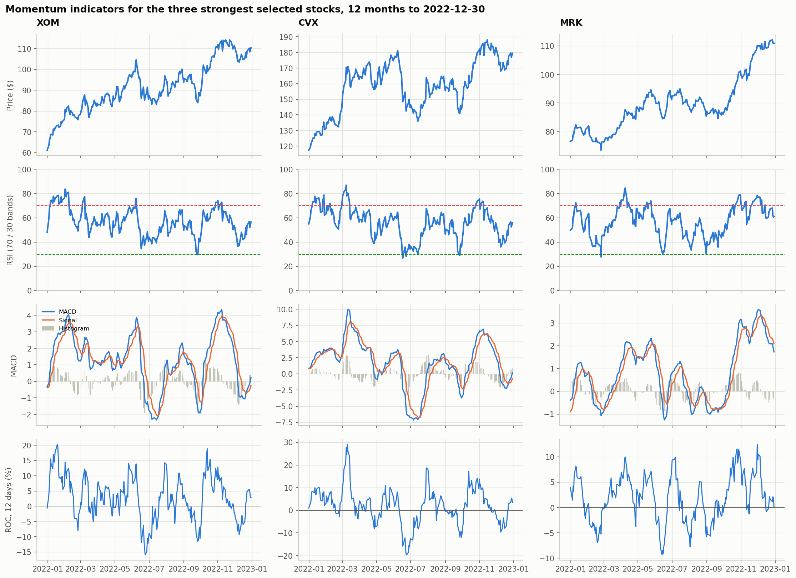
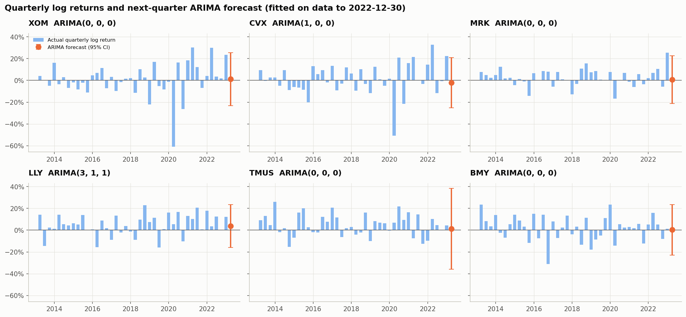
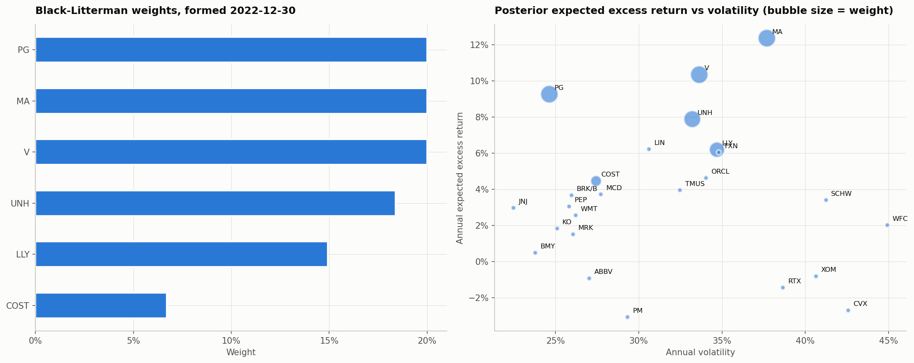

# How the baseline pipeline works

[← Back to the README](../README.md)

All the main work is in [`main.ipynb`](../main.ipynb). On each rebalance date (the last trading day of each quarter), it runs:

```
Clean data ─▶ Point-in-time universe ─▶ Momentum selection ─▶ ARIMA views ─▶ Black-Litterman ─▶ Hold one quarter (pay costs)
```

1. **Data cleaning.** Removes exchange suffixes from tickers (`AAPL UW Equity` → `AAPL`). Drops blank rows (28% of the raw file) *before* de-duplicating. When a company has two listings with different prices, keeps the one named in that date's S&P 500 snapshot.
2. **Point-in-time universe.** The 50 largest stocks that were **in the S&P 500 on that date**, taken from the quarterly constituent snapshots. This avoids survivorship bias.
3. **Momentum selection.** Ranks the universe by 12-1 month momentum (12-month return, skipping the latest month), excludes overbought stocks (RSI > 70), and keeps the top 25.

   

4. **ARIMA views.** `auto_arima` on each stock's quarterly **log returns**, with no seasonal term and the intercept forced on. The next-quarter forecast becomes the stock's Black-Litterman view. The 95% intervals are wide, so the views carry little information. Forecasts are fitted in parallel and cached.

   

5. **Black-Litterman.** A market-cap-implied prior blended with the ARIMA views, all in annual excess returns, using a Ledoit-Wolf shrunk covariance. The optimiser maximises Sharpe, long-only, with at most 20% in any one stock.

   

6. **Backtest.** Holdings drift with prices for one quarter, then the process re-runs using only data up to the next rebalance date. Every portfolio, benchmarks included, pays 10 bps per unit traded.
