# Results in full

[← Back to the README](../README.md)

Every result of the project, phase by phase, with all charts. 2010–2023 unless stated, walk-forward, after 10 bps costs, price returns. The numbers come from the notebooks and `results/`.

## Phases 1–4: the baseline strategy

2010–2023, walk-forward, after 10 bps costs, price returns. Sharpe ratios in Phases 1–7 subtract a constant 3% risk-free rate; with the actual T-bill rate (Phase 8) every Sharpe ratio is 0.10–0.13 higher and the strategy trails the S&P 500 proxy (0.625 vs 0.640):

| | CAGR | Volatility | Sharpe | Max drawdown | Turnover / yr | t-stat vs S&P | 2023 |
|---|---|---|---|---|---|---|---|
| **Strategy** | **12.2%** | 20.4% | **0.52** | −33.0% | 453% | 0.58 | 11.5% |
| Equal-weight top 50 | 10.1% | 16.8% | 0.48 | −31.1% | 67% | −1.46 | 23.1% |
| Cap-weight top 50 | 11.5% | 17.9% | 0.53 | −30.0% | 22% | 0.51 | 37.2% |
| Cap-weight S&P 500 (index proxy) | 11.1% | 17.5% | 0.52 | −33.6% | 8% | — | 25.7% |

The S&P 500 proxy tracks the real index closely: 25.6% vs 24.2% before costs in 2023, and 11.1% vs about 10.9% a year over 2010–2023.

### Year by year

The strategy beat the S&P 500 proxy in 8 of 14 years, but its bad years (2010, 2016, 2023) were large.

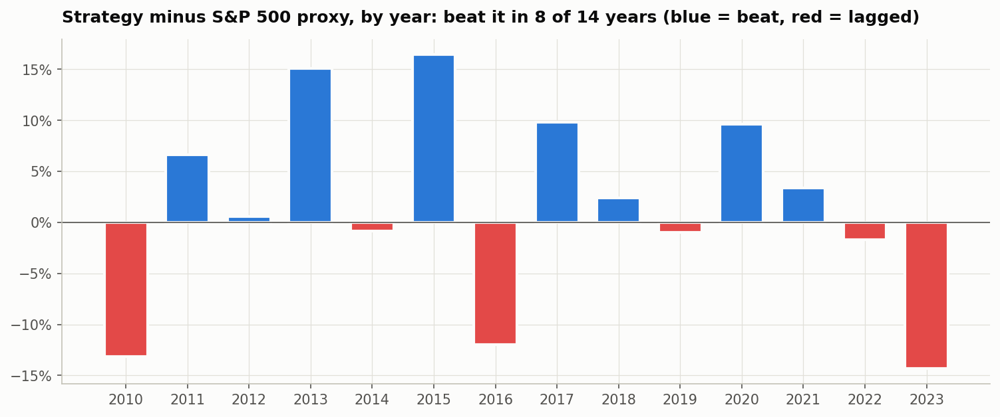

### Risk over time

Drawdowns are similar to the index's, but the strategy's rolling 3-year Sharpe has fallen behind since 2022.

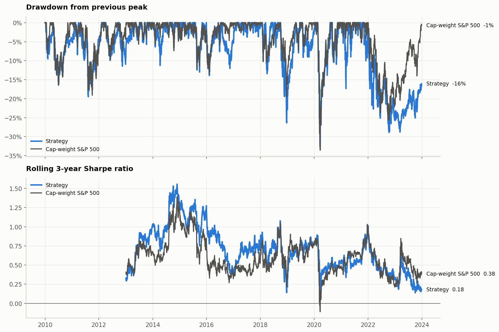

### Where the return comes from

Each layer was added one at a time. Momentum, the optimiser and the ARIMA views each move the Sharpe ratio by 0.03 or less, while turnover rises nearly sevenfold.

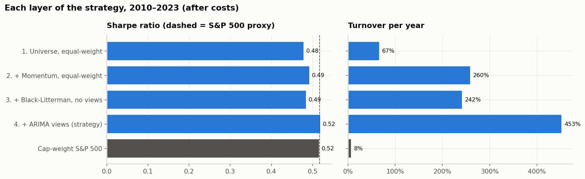

### How sensitive the result is

Across 13 variants of the settings and costs, the Sharpe ranges from 0.43 to 0.60. None is statistically significant (best t-statistic ≈ 1.2).

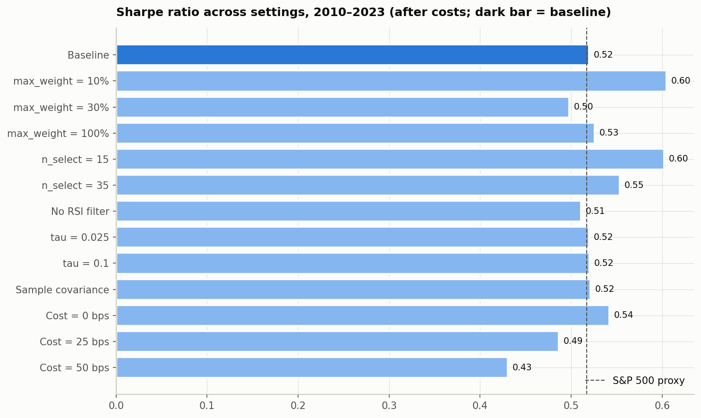

### Transaction costs

The strategy trades a lot, so costs matter: its edge over the S&P 500 proxy disappears at about **45 bps** per trade.

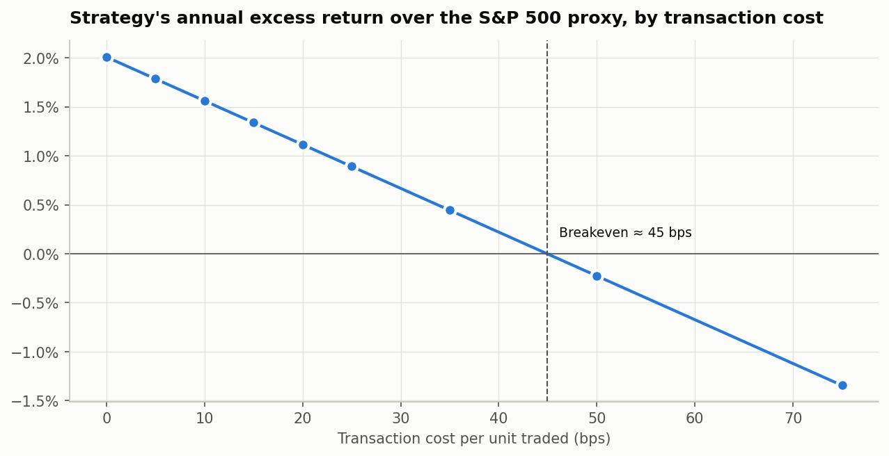

### Full S&P 500 universe

Running the same momentum selection on all ~500 members made results **worse**. The strategy's Sharpe fell to 0.29, and classic top-decile momentum got 0.33, against 0.47 for equal-weight S&P 500. Large-cap US momentum was a weak factor in 2010–2023.

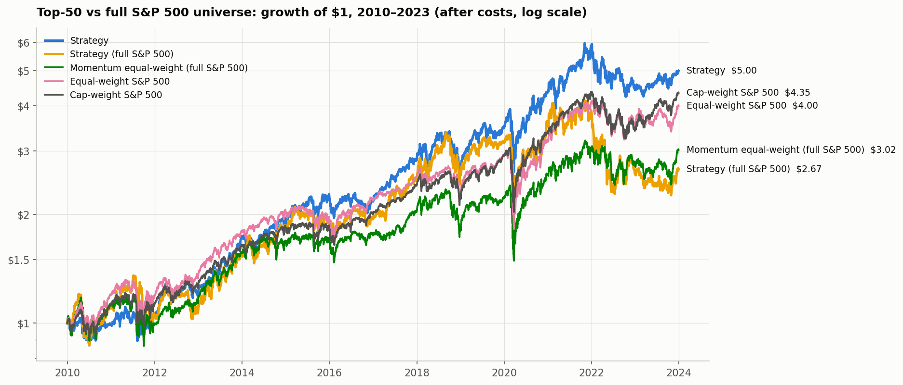

### Reducing turnover

Moving only 50% of the way to the target each quarter halves turnover (453% → 225%) and raises the Sharpe to 0.58 (t-statistic 1.15). No-trade bands barely help, because most trades are whole-position swaps. This was found after testing several variants, so it needs confirming on fresh data.

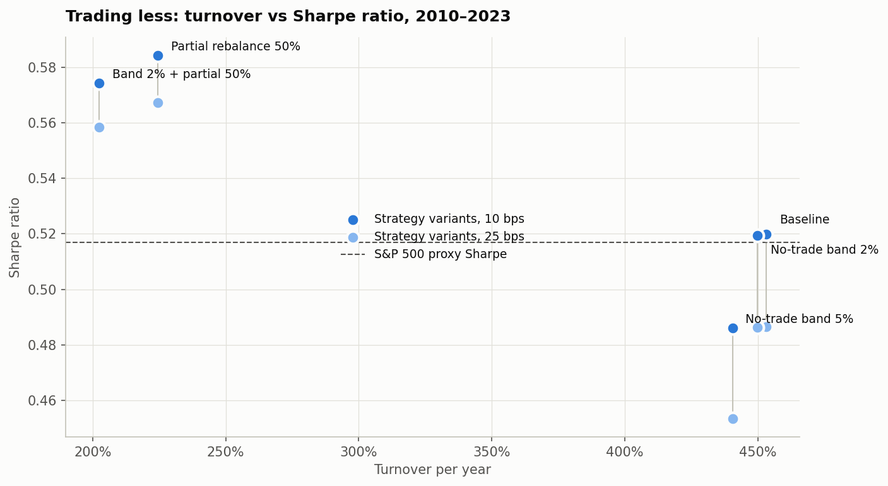

### 2023 test year

Momentum at the end of 2022 pointed towards energy and defensive stocks, while 2023 was led by mega-cap tech: 11.5% for the strategy against 25.7% for the S&P proxy.

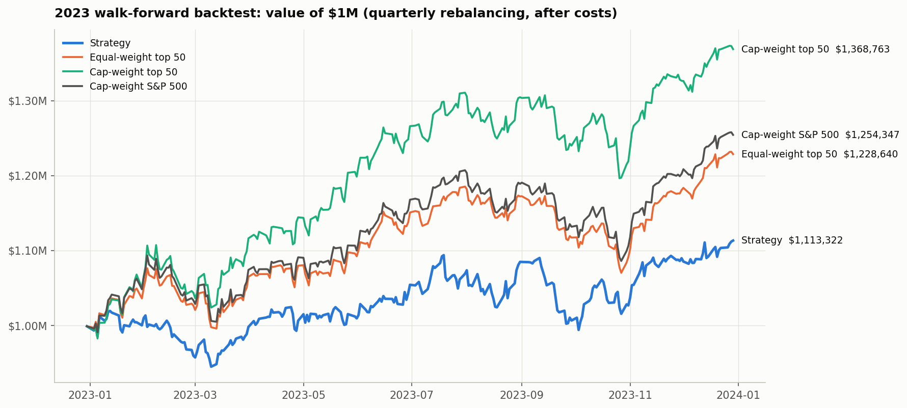

---

## Signal research (Phase 5)

[`signal-research.ipynb`](../signal-research.ipynb) tests each signal on its own before building portfolios, then
turns signals into expected returns the standard way and measures how much of the signal reaches the portfolio.
Monthly, 2003–2023, point-in-time S&P 500 (about 500 stocks) and its 50 largest members.

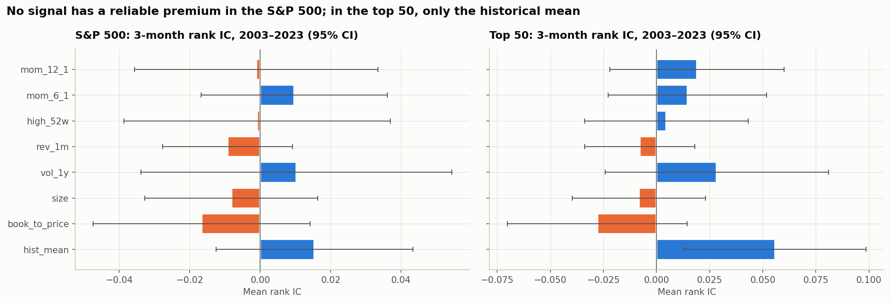

* **No momentum premium.** In the full S&P 500 no signal has a significant information coefficient (IC) at
  1, 3, 6 or 12 months. 12-1 momentum's top-minus-bottom quintile earned −1.8% a year (t −0.41); it crashed
  in the 2009 rebound and never recovered.
* **The historical-mean signal is the 2017–2023 growth rally.** It is the only significant signal in the top 50
  (3-month IC 0.056, t 2.5), but its IC is 0.001 in 2003–2009, 0.034 in 2010–2016 and 0.136 in 2017–2023, and
  it falls to t 1.21 once momentum, size, volatility, value and reversal are controlled for (Fama-MacBeth). It
  is correlated −0.35 with book-to-price: it picks growth stocks.

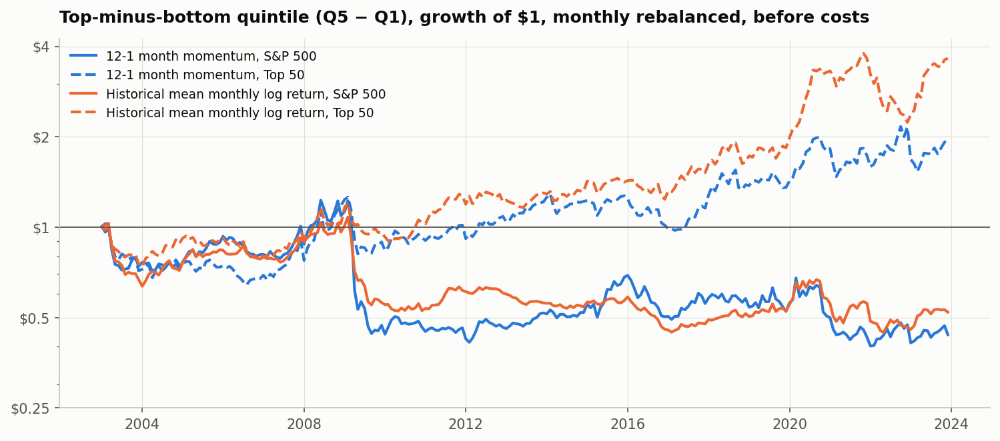

* **Grinold alphas** (alpha = IC × volatility × z-score, IC estimated only from past data) make the portfolio
  follow its signal: the transfer coefficient rises from about 0.16 to 0.70, and it holds 12–23 names instead
  of 7. With no alpha, the optimiser returns the market portfolio, as it should.
* **But the signals are weak and max-Sharpe overtrades them.** A momentum alpha with a standard deviation of
  0.8% a year still produces 344% turnover and a Sharpe of 0.42. The historical-mean alpha reaches 0.54 but
  with a −50.5% drawdown in 2021-22, holding Tesla and Mastercard at the 20% cap.
* **Since 2005, nothing beats cap-weighting** (Sharpe 0.32 for both benchmarks, including 2008-09).
* **A bug in the ARIMA views:** they were median, not expected, returns, which penalised volatile stocks.
  Correcting them raises the baseline's Sharpe from 0.52 to 0.60 (t 1.26, not significant).

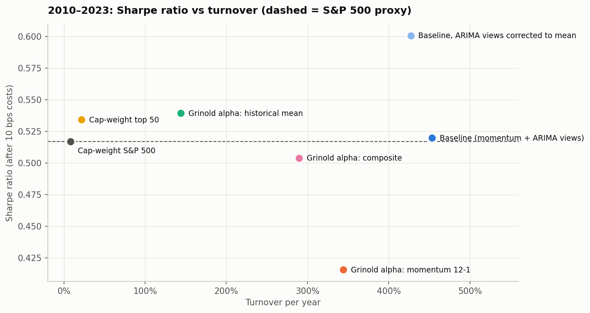

---

## Portfolio construction (Phase 6)

[`portfolio-construction.ipynb`](../portfolio-construction.ipynb) replaces max-Sharpe with the standard
active-management setup: a **statistical risk model** (5 principal components of daily returns plus each
stock's specific risk) and a **benchmark-relative optimiser** that maximises alpha minus a penalty on
tracking error against the cap-weighted top 50 and the cost of each trade:

$$\max_w \; h\,\alpha^\top(w-b) - h\,\lambda\,(w-b)^\top\Sigma(w-b) - \kappa\,c\,\lVert w - w_{\text{current}}\rVert_1$$

long-only, at most 20% per stock, tracking error at most 4%. Alphas are Phase 5's Grinold alphas, now
scaled by specific volatility. Main settings: $\lambda = 10$ (from Grinold's TE ≈ IC√N/λ, about 2% here)
and $\kappa = 1$ (trades charged at their real cost).

2010–2023, after 10 bps costs; active statistics against the cap-weighted top 50:

| | Sharpe | Turnover / yr | Active return | Tracking error | IR (t) | Max drawdown |
|---|---|---|---|---|---|---|
| Active: historical mean | 0.54 | 28% | +0.3% | 1.6% | 0.16 (0.61) | −31.3% |
| Active: momentum 12-1 | 0.54 | 25% | +0.1% | 0.8% | 0.09 (0.34) | −29.5% |
| Active: composite | 0.54 | 40% | +0.3% | 1.5% | 0.20 (0.74) | −30.1% |
| Phase 5 max-Sharpe: historical mean | 0.54 | 144% | +2.4% | 9.4% | 0.26 (0.97) | −50.5% |
| Phase 5 max-Sharpe: momentum 12-1 | 0.42 | 344% | −1.3% | 7.6% | −0.17 (−0.65) | −32.3% |
| Cap-weight top 50 | 0.53 | 22% | — | — | — | −30.0% |

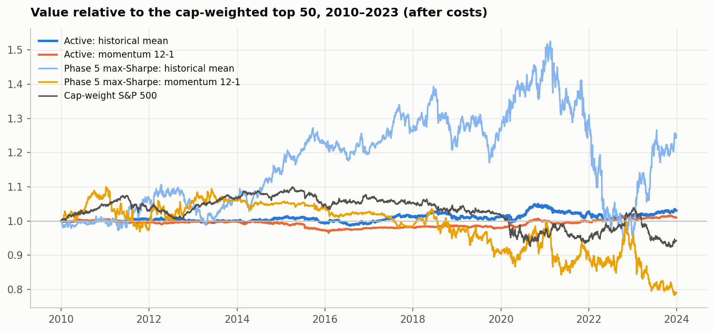

* **The construction problem is solved.** The same or a higher Sharpe ratio for a fifth of the turnover or
  less (the benchmark itself turns over 22% from index changes), tracking error of 0.8–1.6% instead of
  7.6–9.4%, and drawdowns within 1.3 points of the benchmark's (−30.0%). The portfolios hold 44–48 names, and 86–89% of their active risk is stock-specific.
* **Which exposes how little the alphas are worth:** +0.1% to +0.3% a year, none significant, and +0.1%,
  −0.1% and +0.2% over 2005–2023.
* **The optimised portfolios were riskier than forecast.** Realised tracking error divided by the forecast (the bias
  statistic) is 1.17 for the historical mean, at the edge of the range expected from an accurate model
  (0.81–1.19), and 1.32–1.57 for the other two. Phase 7 finds why: not the risk model itself, which is
  accurate for random portfolios, but misalignment between the alpha and the risk model.
* **Sensitivity** (every setting reported): more active risk adds a little return for the historical mean
  (+1.3% at 3.9% tracking error, t 1.20) and none for momentum; a higher trading penalty cuts turnover to
  11–15% at no cost in return.

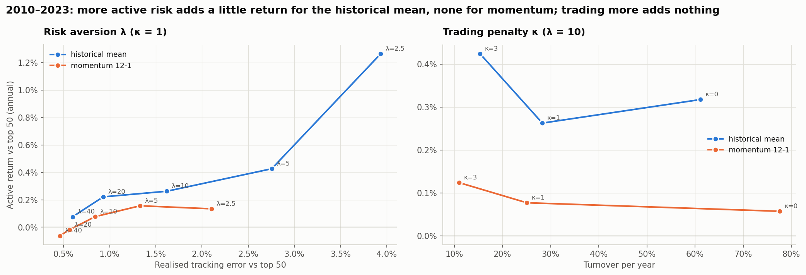

---

## Momentum variants and risk forecasts (Phase 7)

[`momentum-variants-and-risk.ipynb`](../momentum-variants-and-risk.ipynb) tests the two standard improvements to
momentum and diagnoses Phase 6's low risk forecasts.

**Volatility-managed momentum** (Barroso & Santa-Clara 2015, their settings: 12% target, 6-month window, at
most 2×) on the S&P 500 top-minus-bottom momentum quintile, 245 months, before costs:

| | Return / yr | Sharpe (t) | Max drawdown | Worst month | Skewness |
|---|---|---|---|---|---|
| 12-1 momentum, raw | −1.0% | −0.05 (−0.23) | −71.8% | −33.6% | −0.89 |
| 12-1 momentum, volatility-managed | +4.0% | 0.31 (1.50) | −29.5% | −11.3% | +0.45 |
| Residual momentum, raw | +1.0% | 0.09 (0.39) | −33.2% | −13.7% | −0.25 |
| Residual momentum, volatility-managed | +2.4% | 0.19 (0.89) | −35.4% | −12.8% | +0.19 |

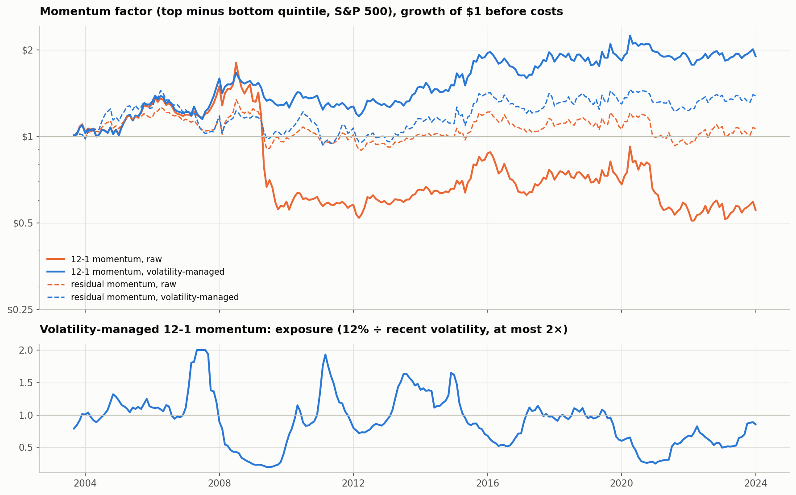

* **Volatility management removes the momentum crash** (−71.8% → −29.5% drawdown, worst month −33.6% → −11.3%),
  reproducing the paper; the higher return is not significant (t 1.50).
* **Residual momentum** (Blitz, Huij & Martens 2011; market factor only) is steadier than 12-1 momentum in the
  top 50 (3-month IC positive in all three sub-periods; quintile spread +4.6% a year, t 1.62) but has no premium
  in the full S&P 500 and adds nothing once 12-1 momentum is controlled for.
* **Neither helps the long-only top-50 portfolio:** through the Phase 6 optimiser both earn 0.0% a year
  against the cap-weighted top 50. There is no momentum information there to scale.
* **The risk model was accurate all along.** Exponential weighting, Phase 6's suggested fix, makes the
  forecasts slightly worse. The model's bias statistic is 0.98 for 11,200 random active portfolios and 0.98
  for specific risk; only optimised portfolios were under-forecast, because the optimiser bets along the alpha,
  which the model had no factor for. Adding the alpha as a factor (Lee & Stefek 2008) brings the
  historical-mean portfolio from 1.17 to 1.10, within the range of an accurate model. Momentum stays at 1.52,
  driven by two extreme quarters (Q3 2020, +5.3 standard deviations; Q3 2015, −4.9).

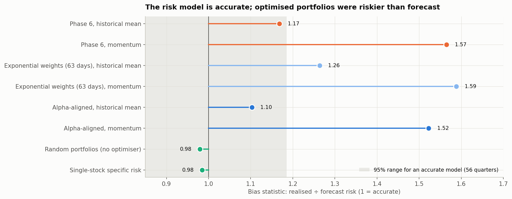

---

## Attribution and robust inference (Phase 8)

[`attribution-and-inference.ipynb`](../attribution-and-inference.ipynb) rebuilds all 47 variants tested in Phases
1–7 (`mts.strategies`) over 2010–2023 and applies four checks. Factor returns and the 1-month T-bill come
from [Kenneth French's data library](https://mba.tuck.dartmouth.edu/pages/faculty/ken.french/data_library.html)
(CRSP vintage 202609; URLs and checksums in `factors/manifest.json`).

| | Sharpe (T-bill) | vs S&P 500 proxy (bootstrap p) | Factor alpha vs S&P 500 proxy (t) | Momentum loading | CMA loading |
|---|---|---|---|---|---|
| Baseline | 0.625 | −0.015 (0.91) | +0.69% (0.30) | +0.22 | −0.24 |
| Best variant by Sharpe (max weight 10%) | 0.715 | +0.075 (0.51) | +1.67% (0.97) | +0.20 | −0.16 |
| Best variant by IR (ARIMA views corrected) | 0.703 | +0.063 (0.66) | +2.41% (1.02) | +0.23 | −0.33 |
| Phase 6 active, historical mean | 0.660 | +0.020 (0.73) | +0.34% (0.43) | +0.04 | −0.14 |
| Cap-weight S&P 500 proxy | 0.640 | — | — | — | — |

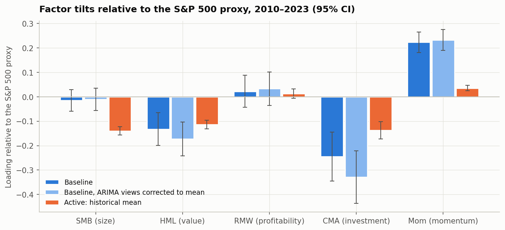

* **Real risk-free rate.** The T-bill averaged 0.84% a year, not 3%. Every Sharpe ratio rises by 0.10–0.13,
  and the baseline now trails the S&P 500 proxy (0.625 vs 0.640). Using the T-bill inside the baseline's
  Black-Litterman views too barely changes it (Sharpe 0.623).
* **Attribution.** Relative to the S&P 500 proxy, the baseline is long momentum (+0.22, t 10.5) and tilted
  against conservative-investment and value stocks (CMA −0.24, HML −0.13): what is left is +0.69% a year
  (t 0.30). The Phase 6 portfolio has the cap-weighted top 50's mega-cap tilts. Across all 47 variants, factor
  alpha t-statistics range from −1.79 to +1.02.
* **Sharpe differences** (block bootstrap): none has a p-value below 0.37.
* **Multiple testing.** The best of 47 information ratios (0.338) beats what luck alone would give (0.238 for
  47 independent tries) but its deflated Sharpe ratio is 0.65, or 0.80–0.85 allowing for how correlated the
  variants are (2.2–4 effective trials); 0.95 is the usual bar.
* **Overfitting.** Within each group of variants, against its own benchmark, the probability of backtest
  overfitting is 0.49 (Phases 1–5) and 0.65 (Phases 6–7), and the in-sample winner's IR falls from 0.46–0.49
  to 0.01–0.12 out of sample.

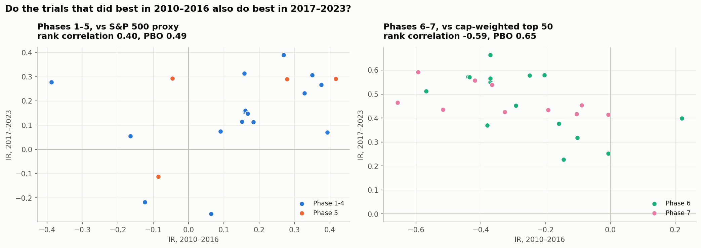
